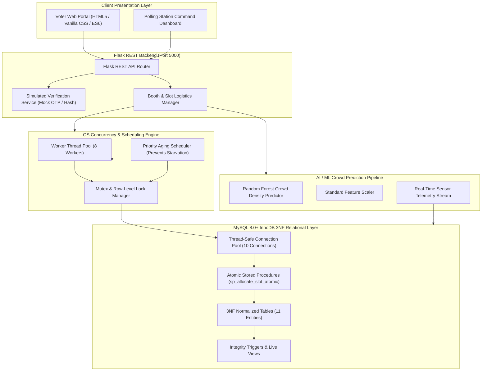

# Smart Polling Booth & Time-Slot Allocation Platform for One Nation One Election

[-blue.svg)](https://en.wikipedia.org/wiki/Bachelor_of_Technology)
[]()
[](https://www.mysql.com/)
[](https://flask.palletsprojects.com/)
[]()

> **A synchronized logistical coordination, OS-inspired priority scheduling, and AI crowd prediction platform designed for the simultaneous execution of Parliamentary (Lok Sabha) and Assembly (Vidhan Sabha) elections under the One Nation One Election (ONOE) paradigm.**

---

## ⚠️ STRICT ARCHITECTURAL & LEGAL GUARDRAILS (DO NOT VIOLATE)

> [!IMPORTANT]
> **1. LOGISTICS ONLY — NOT VOTING:**  
> This software is strictly an **electoral logistics and infrastructure coordination system**. It manages polling booth assignment, simulated demographic verification, arrival time-slot scheduling, and real-time crowd density mitigation.  
> **It explicitly DOES NOT:**
> - Cast, record, store, or count votes or electronic ballots.
> - Display, rank, or select political candidates or political parties.
> - Conduct political campaigning, exit polls, or election outcome forecasting.

> [!NOTE]
> **2. PRIVACY & SYNTHETIC IDENTITY ONLY:**  
> To guarantee complete privacy and zero misuse:
> - **NO real government identity numbers** (e.g., actual Aadhaar, real Voter ID / EPIC) are accepted, stored, or processed.
> - All demo voter profiles use **synthetic test identifiers** strictly conforming to the format:  
>   `demo_epic_no`: **`DEM-UK-2026-XXXX`** (e.g., `DEM-UK-2026-0001` through `DEM-UK-2026-0060`).
> - Authentication is simulated using synthetic one-time tokens (`SIM-OTP-XXXXXX`) and mock cryptographic hashes.

> [!CAUTION]
> **3. STRICT NAMING CONTRACT:**  
> Every SQL table name, column, relational constraint, and stored procedure created in the database schema serves as the single source of truth across the Flask REST backend, the OS Concurrency Engine, and the academic synopsis. **Do not modify or rename database tables or columns.**

---

## 🏛️ System Architecture

The platform bridges **Database Management Systems (3NF normalization, ACID row-level locking)**, **Operating Systems principles (thread pooling, mutex synchronization, priority aging)**, and **Machine Learning (random forest crowd congestion regression)**.



---

## 📂 Project Directory Structure

```text
DBMS OS PBL/
├── .env.example                     # Environment template with exact configuration keys
├── .gitignore                        # Git exclusion rules for secrets, virtual environments, cache
├── requirements.txt                  # Python dependencies (Flask, MySQL, Scikit-Learn, PyTest)
├── README.md                         # Comprehensive architectural guide & documentation
│
├── database/                         # Complete 3NF MySQL Database Layer
│   ├── .gitkeep
│   ├── schema.sql                    # 3NF Schema: 11 tables, constraints, stored procedures, triggers, views
│   ├── seed_data.sql                 # 100% synthetic seed data (DEM-UK-2026-XXXX format, dual ONOE mapping)
│   ├── db_pool.py                    # Thread-safe MySQL connection pool manager
│   └── init_db.py                    # Automated database migration and verification CLI script
│
├── docs/                             # Academic & Technical Documentation
│   ├── .gitkeep
│   └── DATABASE_SPECIFICATION.md     # 3NF mathematical proof, functional dependencies & data dictionary
│
├── backend/                          # Flask REST API Backend
│   └── app/
│       ├── os_engine/                # OS Concurrency, Thread Pool, Mutex & Priority Aging
│       │   └── .gitkeep
│       ├── services/                 # Business logic, verification, slot management
│       │   └── .gitkeep
│       └── routes/                   # API Blueprint route controllers
│           └── .gitkeep
│
├── ml_pipeline/                      # Crowd Prediction ML Pipeline
│   └── artifacts/                    # Trained Scikit-Learn model artifacts & scalers
│       └── .gitkeep
│
├── frontend/                         # Responsive Vanilla CSS & JS Web Interface
│   ├── css/
│   │   └── .gitkeep
│   └── js/
│       └── .gitkeep
│
├── tests/                            # Unit & Concurrency Stress Tests
│   └── .gitkeep
│
└── logs/                             # System execution & thread audit logs
    └── .gitkeep
```

---

## 📊 Database 3NF Normalization Layer

The database schema (`database/schema.sql`) adheres to **Third Normal Form (3NF)** with strict referential integrity under the **InnoDB** storage engine.

### Core Relational Entities

1. **`states`**: State territorial metadata (`state_code`, `state_name`).
2. **`constituencies`**: Dual One Nation One Election hierarchy:
   - **Parliamentary Constituency (PC)**: Lok Sabha jurisdiction (e.g., Haridwar, Tehri Garhwal).
   - **Assembly Constituency (AC)**: Vidhan Sabha jurisdiction nested within the Parliamentary Constituency (e.g., Dehradun Cantt, Rishikesh).
3. **`polling_stations`**: Physical school/college campus facilities (`address`, `pincode`, `latitude`, `longitude`, `has_wheelchair_ramp`).
4. **`polling_booths`**: Individual room/counter inside the station mapped concurrently to both its Parliamentary (PC) and Assembly (AC) constituencies.
5. **`voters`**: Synthetic demo registry with synthetic `demo_epic_no` (`DEM-UK-2026-XXXX`) and priority tiers (`SENIOR_CITIZEN`, `PERSON_WITH_DISABILITY`, `PREGNANT_WOMEN`, `GENERAL`).
6. **`election_events`**: Election schedule cycles (`ONOE_SIMULTANEOUS`).
7. **`time_slots`**: Discretized arrival windows per booth (e.g., `07:00-09:30`, `09:30-12:00`) with reserved priority quotas.
8. **`slot_allocations`**: Cryptographically secure booking reservations and sequential queue tokens.
9. **`simulated_verifications`**: Privacy-safe simulated verification tokens (`SIM-OTP-XXXXXX`, `SIM-EPIC-HASH-XX`).
10. **`crowd_telemetry`**: Sensor data (queue length, service times, congestion index) for real-time ML feature ingestion.
11. **`os_concurrency_audit`**: High-resolution timestamped log of thread mutex locks, wait times, and priority aging promotions.

### ACID Concurrency Guarantees

- **Atomic Row-Level Locking:** Stored procedure [`sp_allocate_slot_atomic`](file:///database/schema.sql) executes `SELECT ... FOR UPDATE` on the target `time_slots` row, blocking concurrent worker threads from causing race conditions or overbooking.
- **Starvation Elimination (OS Aging):** Wait times are dynamically computed. As unreserved voters wait in queue, their `priority_score` increases incrementally via background aging threads.
- **Rollback Resilience:** Database triggers and SQL exception handlers automatically execute `ROLLBACK` on constraint violations, ensuring zero partial writes.

---

## 🚀 Quickstart & Setup Instructions

### 1. Prerequisites
- **Python:** 3.10+ (Installed & available in system PATH)
- **MySQL Server:** 8.0+ or 8.4 LTS (Running on port `3306`)

### 2. Configure Environment Variables
Copy `.env.example` to `.env` and set your MySQL password:
```powershell
Copy-Item .env.example .env
```

Ensure the keys match your local MySQL configuration:
```ini
FLASK_ENV=development
FLASK_PORT=5000
SECRET_KEY=dev-secret-key-change-in-production
JWT_SECRET_KEY=jwt-admin-secret-2026

# MySQL 8.0+ InnoDB Connection Pool Settings
DB_HOST=127.0.0.1
DB_PORT=3306
DB_USER=root
DB_PASSWORD=your_mysql_password
DB_NAME=smart_poll_allocation_db
DB_POOL_SIZE=10

# OS Engine & Scheduler Configuration
OS_SCHEDULER_POLICY=PRIORITY_AGING
OS_MAX_WORKER_THREADS=8
OS_LOCK_TIMEOUT_SECONDS=5
BOOTH_CACHE_TTL_SECONDS=300

# AI/ML Crowd Prediction Artifacts
ML_MODEL_PATH=ml_pipeline/artifacts/rf_crowd_model.joblib
ML_SCALER_PATH=ml_pipeline/artifacts/feature_scaler.joblib
ML_FALLBACK_ENABLED=true
```

### 3. Install Python Dependencies
```powershell
python -m pip install -r requirements.txt
```

### 4. Initialize Database Schema & Seed Data
Execute the automated migration script:
```powershell
python database/init_db.py
```
*Alternatively, run the SQL scripts directly via MySQL CLI:*
```powershell
& "C:\Program Files\MySQL\MySQL Server 8.4\bin\mysql.exe" -u root -p < database/schema.sql
& "C:\Program Files\MySQL\MySQL Server 8.4\bin\mysql.exe" -u root -p < database/seed_data.sql
```

---

## 🧪 Synthetic Data Demonstration Specs

All sample data provided in `database/seed_data.sql` uses strictly synthetic, randomized demographic records:

| Parameter | Demonstration Value | Specification Rule |
| :--- | :--- | :--- |
| **State** | Uttarakhand (`UK`) | Federal State identifier |
| **Parliamentary (PC)** | Haridwar (`PC-UK-01`), Tehri Garhwal (`PC-UK-02`) | Lok Sabha election layer |
| **Assembly (AC)** | Dehradun Cantt (`AC-UK-01`), Rishikesh (`AC-UK-03`), etc. | Vidhan Sabha election layer |
| **Demo EPIC Format** | `DEM-UK-2026-0001` to `DEM-UK-2026-0060` | 100% Synthetic Demo Numbers |
| **Priority Tiers** | `1` (Senior Citizens 70+, PwD, Expectant Mothers), `3` (General) | Queue dispatch priority |
| **Time Windows** | 4 daily slots (07:00-09:30, 09:30-12:00, 12:30-15:00, 15:00-17:30) | Crowd flattening discretization |
