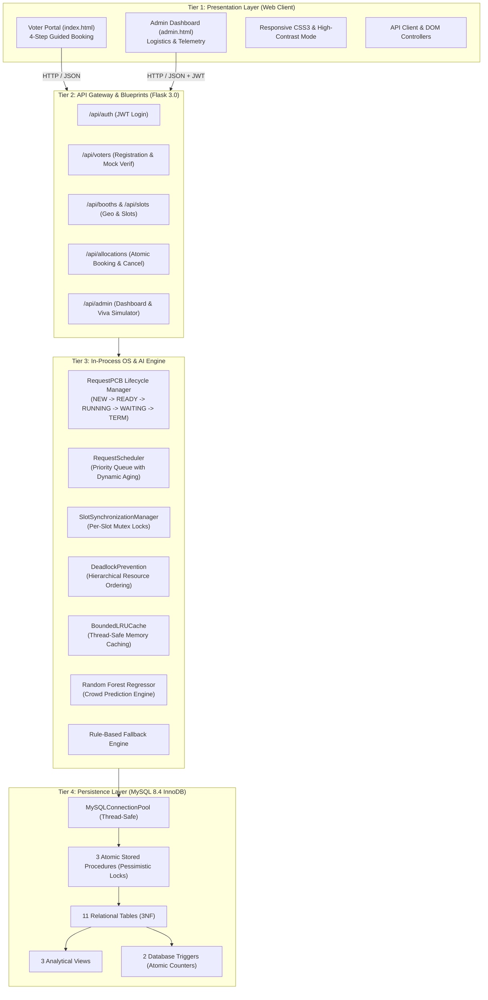
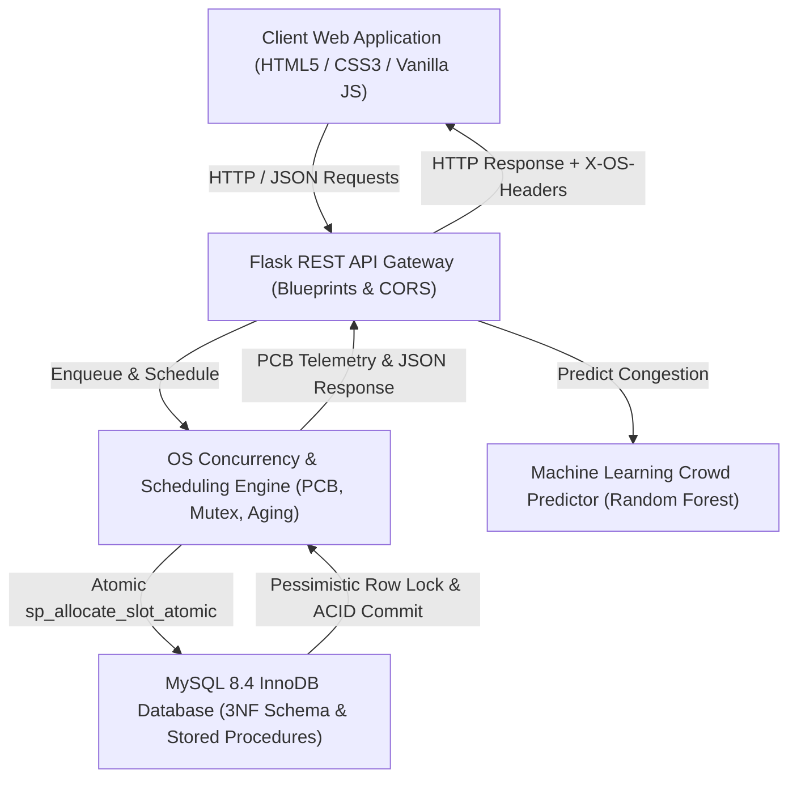
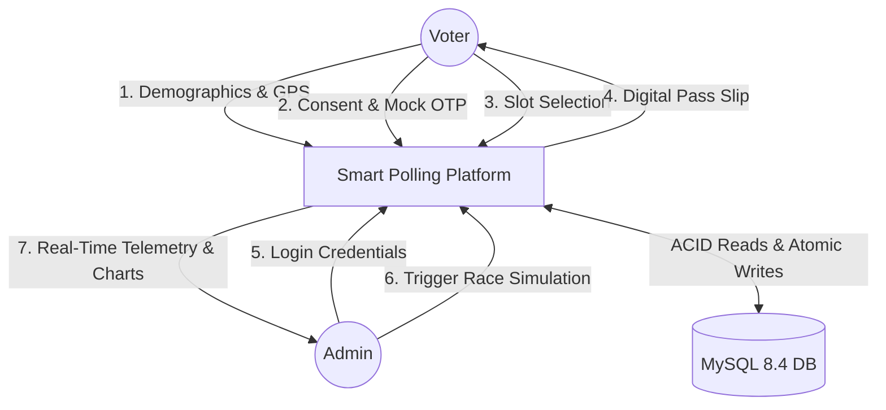
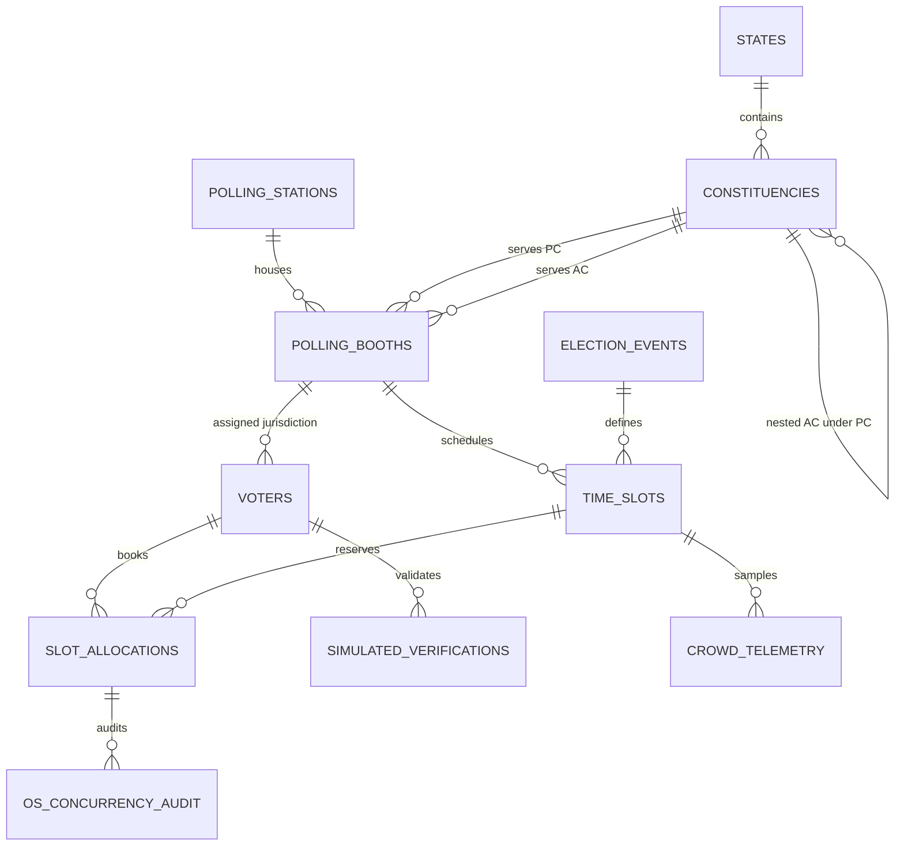
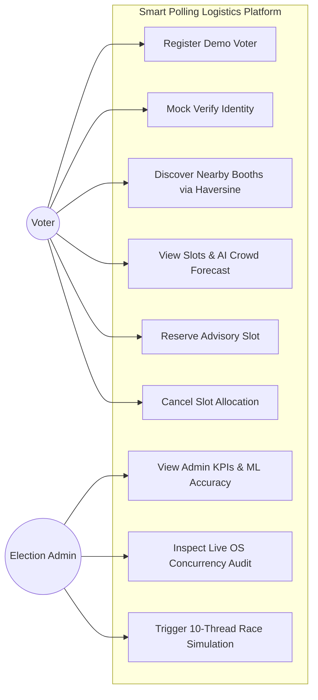
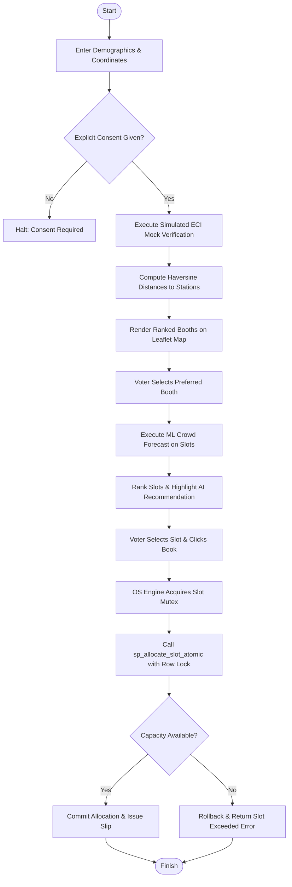
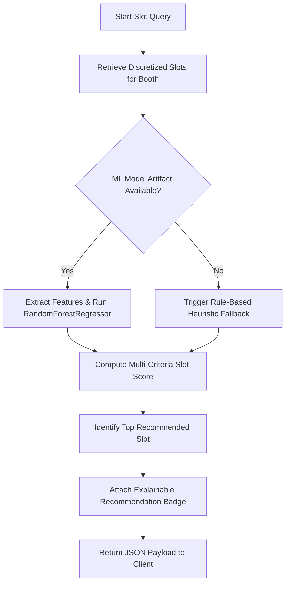
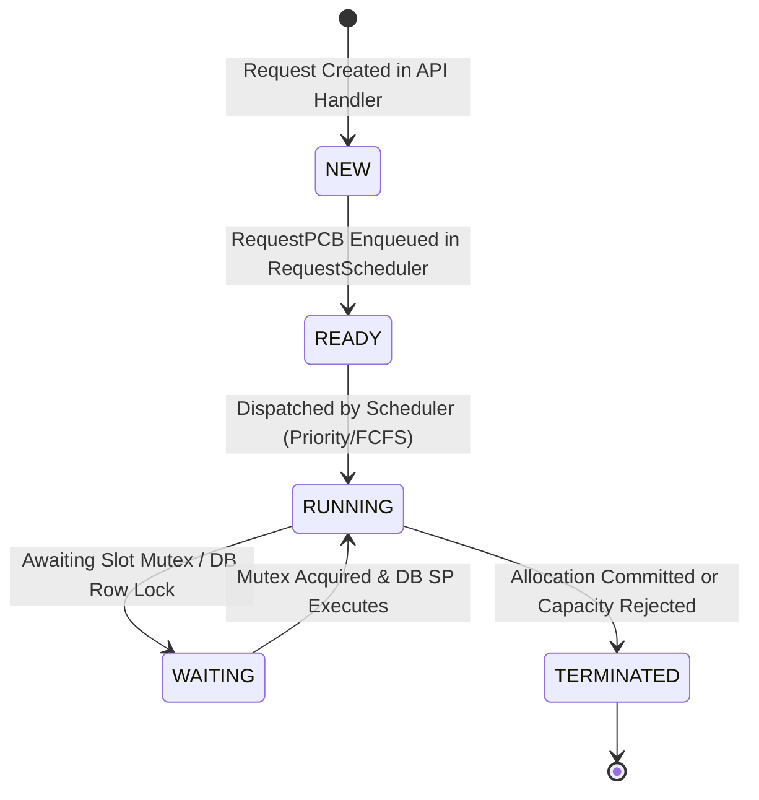

# VoteIT — Smart Polling Booth & Time-Slot Allocation Platform for One Nation One Election (ONOE)
## Academic Project Synopsis & Technical Specification

---

## 1. Title Page

- **Project Title:** VoteIT — Smart Polling Booth & Time-Slot Allocation Platform for One Nation One Election
- **Academic Domain:** Cross-Discipline Integration of Artificial Intelligence & Machine Learning (AI/ML), Operating Systems (OS), Database Management Systems (DBMS), System Design, and Modern Web Architecture
- **Degree / Curriculum:** Bachelor of Technology (B.Tech) in Computer Science and Engineering (Specialization: AI & ML)
- **Academic Context:** DBMS & OS Project-Based Learning (PBL) Capstone Prototype
- **Date of Formulation:** October 2026
- **Geographic Context for Simulation:** Uttarakhand State Electoral Constituencies (Dehradun, Haridwar, Haldwani, Nainital)

---

## 2. Abstract

The simultaneous conduct of parliamentary (Lok Sabha) and legislative assembly (Vidhan Sabha) elections—popularly termed "One Nation, One Election" (ONOE)—presents unprecedented logistical challenges to polling station queue management. Dual-ballot casting roughly doubles per-voter dwell time at Electronic Voting Machine (EVM) compartments, intensifying queue bottlenecks, voter fatigue, and peak-hour crowding. This capstone engineering project presents the **Smart Polling Booth & Time-Slot Allocation Platform**, an end-to-end, full-stack, queue-logistics scheduling prototype designed to regulate voter arrival waves, balance booth utilization, and eliminate race conditions during concurrent seat reservations.

The system is architected across five decoupled tiers: a responsive, accessible Web UI (Vanilla HTML5/CSS3/JavaScript with high-contrast assistive toggle); a Python Flask RESTful API (12 core endpoints); an in-process Operating System Concurrency & Process Scheduling Engine; a Machine Learning crowd prediction engine; and a relational MySQL 8.4 InnoDB persistence layer normalized strictly to Third Normal Form (3NF) across 11 tables, 3 analytical views, 3 stored procedures, and 2 database triggers. 

To eliminate concurrent booking race conditions and overbooking vulnerabilities, the platform implements a dual-layer synchronization model: thread-level mutex locking with Process Control Blocks (`RequestPCB`) in the OS engine and pessimistic row-level locking (`SELECT ... FOR UPDATE`) within the atomic stored procedure `sp_allocate_slot_atomic`. Process aging is enforced to prevent starvation of low-priority general requests amidst high-priority requests from senior citizens and persons with disabilities. 

To forecast booth congestion, an automated AI pipeline trains a Scikit-Learn `RandomForestRegressor` against historical arrival telemetry. On synthetic prototype evaluation datasets, the Random Forest model achieves an $R^2$ score of **0.9491** and a Mean Absolute Error (MAE) of **1.5724 voters/slot**, outperforming the empirical baseline (MAE = **6.5712**, $R^2 = -0.0634$) by **76.1%**. A multi-criteria heuristic scoring algorithm combines spatial proximity (Haversine distance), accessibility ramp requirements, and predicted crowd density to recommend optimal, low-friction voting windows with explainable recommendation rationale. 

Extensive automated testing using `pytest` validates zero overbooking under 10-thread simultaneous barrier contention, complete transactional integrity, and smooth end-to-end execution across 39 unit, service, database, ML, and integration tests.

---

## 3. Introduction

Democratic elections in large republics represent the largest peacetime logistical mobilizations in the world. In India, general elections require deploying millions of polling personnel, security forces, and Electronic Voting Machines across hundreds of thousands of polling locations. Under standard staggered election cycles, voters cast a single ballot during their visit. Under a synchronized "One Nation, One Election" framework, voters cast simultaneous ballots for both the Parliamentary Constituency (Lok Sabha) and the Legislative Assembly Constituency (Vidhan Sabha).

While the ONOE concept offers substantial cost savings and administrative efficiencies, it introduces acute operational stress at the polling booth level:
1. **Compounded Service Time:** Having voters cast two distinct ballots in succession increases dwell time inside the polling booth from approximately 45–60 seconds to 90–150 seconds.
2. **Uncoordinated Arrival Waves:** Without pre-scheduled arrival windows, voter arrivals follow unpredictable Poisson-distributed bursts—typically clustered during early morning (07:00–09:00) and late afternoon (16:00–18:00)—leading to excessive queues, prolonged outdoor wait times, and voter abandonment.
3. **Uneven Spatial Load Distribution:** Adjacent polling booths within the same polling station frequently experience wild discrepancies in line lengths due to arbitrary alphabetized voter roll splits.
4. **Accessibility Barriers:** Senior citizens, pregnant women, and persons with disabilities (PwD) are disproportionately impacted by standing in long, uncontrolled physical queues.

This project addresses these challenges by developing a comprehensive, software-driven queue logistics management platform. By enabling citizens to voluntarily schedule advisory time slots at geo-ranked polling booths while providing election administrators with real-time crowd telemetry and predictive analytics, the system flattens arrival peaks and streamlines polling logistics without compromising universal adult suffrage.

---

## 4. Background and Motivation

### 4.1 Logistical Reality of Simultaneous Elections
Under traditional single-election voting, the voter identification, indelible ink marking, register signing, and ballot button pressing workflow follows a relatively smooth pipeline. However, simultaneous elections introduce structural queuing delays:
- Two EVM Ballot Units and two VVPAT (Voter Verifiable Paper Audit Trail) printing cycles per voter.
- Increased cognitive processing time for voters navigating two distinct candidate lists.
- Heightened verification overhead for presiding polling officers cross-checking dual electoral rolls.

Without proactive arrival scheduling, queue lengths at urban and rural booths can grow exponentially during peak hours, creating security concerns, health hazards during extreme weather, and logistical gridlock.

### 4.2 The Role of Operating Systems & DBMS in Election Logistics
Queue scheduling at scale is fundamentally an Operating Systems and Database Concurrency problem:
- When thousands of citizens attempt to reserve limited time slots within minutes of booking opening, web servers face severe **race conditions**. Without strict mutual exclusion and atomic database transactions, overbooking will occur, destroying booth capacity caps.
- Prioritizing vulnerable demographics (senior citizens, persons with disabilities) without starving general-category citizens requires classical **CPU priority scheduling with dynamic aging mechanisms**.
- Managing concurrent resource reallocation (cancelling one slot while booking another) introduces the risk of **deadlock**, requiring strict resource ordering.

### 4.3 Motivation for Academic Capstone
This project bridges theoretical computer science curricula with critical public-sector system design:
- It grounds classical Operating Systems concepts (process states, PCB, mutual exclusion, semaphores/mutexes, Coffman deadlock conditions, LRU caching) into actionable Python implementations.
- It enforces strict relational database rigor (3NF normalization, ACID guarantees, composite indexing, stored procedures, triggers, row-level pessimistic locking).
- It applies modern Machine Learning regression to public infrastructure logistics, benchmarking ensemble decision trees against heuristic baselines.

---

## 5. Problem Statement

Modern polling logistics suffer from three systemic failures:

1. **Stochastic and Burst-Prone Voter Arrival Patterns:** Citizens arrive at polling stations in uncoordinated, heavy waves, causing queue overflow, voter fatigue, and high drop-off rates during peak hours, contrasted with complete idle time during mid-day intervals.
2. **Absence of Capacity-Aware Time-Slot Reservations:** Conventional election management systems provide static voter card lookups but offer zero real-time visibility into booth crowding, zero ability to stagger arrivals across discretized time windows, and no assistive slot reservations for vulnerable demographics.
3. **Vulnerability to Concurrent Overbooking & Race Conditions:** In naive web booking implementations, concurrent HTTP reservation requests for the last available slot at a popular time window lead to lost updates, dirty reads, and severe overbooking, exceeding booth fire-safety and EVM capacity limits.

**Formal Objective:** Design, build, and empirically validate an integrated AI, OS, and DBMS software platform that predicts polling booth crowd demand, assigns optimized advisory time slots via multi-criteria heuristic scoring, prevents concurrent overbooking through OS mutex synchronization and database row locks, and delivers real-time operational telemetry to election administrators.

---

## 6. Existing System and Its Limitations

The existing electoral logistics workflow in India and many democratic jurisdictions relies heavily on static, paper-driven, or read-only digital portals. The table below contrasts the limitations of the existing system with the capabilities of our proposed smart platform:

| Evaluation Dimension | Existing Polling Logistics System | Proposed Smart Polling & Time-Slot Platform |
| :--- | :--- | :--- |
| **Voter Scheduling** | **None.** Voters arrive at will anytime between 07:00 and 18:00, leading to massive queue variance. | **Discretized Advisory Slots:** 2-hour discretized booking windows with capacity caps that stagger arrival volume. |
| **Crowd Prediction** | **None.** Historical turnout is analyzed post-election via static Excel spreadsheets. | **Machine Learning Demand Forecaster:** Scikit-Learn `RandomForestRegressor` predicting arrival volume per slot ($R^2 = 0.9491$). |
| **Voter Prioritization** | **Informal / Manual:** Presiding officers manually break queues to let elderly voters cut ahead, creating friction. | **OS Priority Scheduling with Aging:** Algorithmic prioritization for seniors and PwD with aging to guarantee fairness. |
| **Concurrency Safety** | **Not Applicable / Naive:** Existing voter roll lookup portals do not support transactional seat reservation. | **Dual-Layer Synchronization:** Thread mutexes + MySQL InnoDB `SELECT ... FOR UPDATE` row locks (Zero Overbooking). |
| **Booth Discovery** | **Static Address Card:** Voter slip lists a text address with no spatial distance or routing information. | **Haversine Geo-Ranking + Interactive Map:** Dynamic Euclidean/Haversine distance calculation and Leaflet map rendering. |
| **Dual Jurisdiction (ONOE)** | **Separate Handling:** Often published on separate notices for Lok Sabha and Vidhan Sabha. | **Simultaneous Dual Tagging:** Synchronized mapping of both Parliamentary (PC) and Assembly (AC) constituencies. |
| **Telemetry & Visibility** | **Delayed Manual Logs:** Presiding officers compile hourly turnout logs by hand on paper forms. | **Live Real-Time Telemetry:** Instant capacity utilization %, LRU cache hit ratios, and real-time concurrency audit logs. |
| **Accessibility Support** | **Variable Physical Ramps:** No upfront visibility into wheelchair ramp infrastructure. | **Filterable Accessibility Metadata:** Upfront filtering for wheelchair accessibility, ground-floor rooms, and priority passes. |

---

## 7. Proposed System

The proposed platform is engineered as a robust, 5-tier modular software system:

```
[Tier 1: Client Layer]      --> Voter Web Portal & Admin Logistics Dashboard (HTML5/CSS3/Vanilla JS)
                                     | (RESTful JSON over HTTP / JWT)
[Tier 2: API Gateway]       --> Flask REST API (12 Endpoints + Health + Viva Simulator)
                                     |
[Tier 3: Auth & Verification]-> Simulated ECI Mock Verifier & JWT Token Generator
                                     |
[Tier 4: Engine Layer]      --> OS Concurrency Engine (RequestPCB, Scheduler, Mutex)
                                 + Geo & AI Recommendation Engine (Haversine, Random Forest)
                                     | (SQL Transactions / Stored Procedures / Connection Pool)
[Tier 5: Persistence Layer] --> MySQL 8.4 InnoDB Database (11 Tables, 3 Views, 3 SPs, 2 Triggers)
```

1. **Client Layer:** High-contrast, responsive web interfaces built with semantic HTML5, Vanilla CSS3 (featuring glassmorphism, flexbox/grid layouts, and a dedicated Senior High-Contrast Mode), and Vanilla JavaScript. Includes Leaflet.js interactive maps and Chart.js crowd analytics with offline graceful fallbacks.
2. **API Gateway Layer:** Modular Flask 3.0 backend exposing 12 REST API endpoints organized into blueprints (`auth`, `voter`, `booth`, `allocation`, `admin`), instrumented with uniform error handlers and OS concurrency telemetry response headers (`X-OS-Concurrency-Engine`).
3. **Verification & Auth Layer:** Stateless simulated ECI verification service supporting simulated OTP and biometric tokens with mandatory explicit citizen consent, alongside cryptographically signed HMAC-SHA256 JWT authentication for election administrators.
4. **Engine Layer:** 
   - *OS Concurrency Engine:* In-process operating system simulation featuring Process Control Blocks (`RequestPCB`), FCFS and Priority Scheduling with starvation-preventing dynamic aging, per-slot mutual exclusion locks (`threading.Lock`), deadlock-free resource ordering, and a thread-safe `BoundedLRUCache`.
   - *Geo & AI Recommendation Engine:* Mathematical Haversine spatial indexing combined with an ensemble Random Forest regression model that forecasts arrival congestion and provides explainable slot recommendations.
5. **Persistence Layer:** MySQL 8.4 database running InnoDB storage engine, normalized to 3NF, utilizing a thread-safe connection pool (`mysql.connector.pooling.MySQLConnectionPool`), atomic stored procedures, and row-level pessimistic locks.

---

## 8. Aim and Objectives

### 8.1 Primary Aim
To architect, implement, and validate an intelligent, concurrency-safe, full-stack software platform that optimizes voter arrival scheduling, forecasts polling booth congestion, and ensures deadlock-free, zero-overbooking transactional reservations for simultaneous parliamentary and assembly elections.

### 8.2 Technical Objectives
1. **Relational Database Engineering:** Design and normalize an 11-table schema to Third Normal Form (3NF), embedding simultaneous Lok Sabha (PC) and Vidhan Sabha (AC) jurisdiction mappings, analytical views, stored procedures, and triggers.
2. **OS Process & Concurrency Control:** Implement an in-memory Operating System engine incorporating Process Control Blocks (`RequestPCB`), priority queue scheduling with dynamic aging, per-slot mutual exclusion locks, and hierarchical resource ordering to prevent deadlocks during seat reallocations.
3. **Database Concurrency & Row Locking:** Construct stored procedures (`sp_allocate_slot_atomic`, `sp_cancel_slot_atomic`) executing `SELECT ... FOR UPDATE` row locks to guarantee zero overbooking during concurrent allocation bursts.
4. **Machine Learning Demand Forecasting:** Develop, train, and evaluate a Scikit-Learn `RandomForestRegressor` against historical crowd telemetry to predict slot-level voter arrivals with explainable feature importance.
5. **Deterministic Heuristic Optimization:** Formulate deterministic Haversine spatial ranking and multi-criteria scoring algorithms that rank booths and slots by physical proximity, accessibility ramps, and predicted congestion.
6. **Robust Rule-Based Fallback:** Engineer an automatic, zero-crash fallback mechanism that seamlessly defaults to rule-based heuristic crowd forecasting if ML model artifacts become corrupted or unavailable.
7. **Accessible & Responsive Web Interface:** Build an accessible, high-contrast, responsive Voter Portal and an Administrative Telemetry Dashboard with Leaflet map visualization and Chart.js analytics.
8. **Automated End-to-End Verification:** Establish a 100% passing automated test suite (`pytest`) covering unit tests, database stress tests, ML validation, live 10-thread race simulations, and documentation integrity.

---

## 9. Project Scope and Exclusions

### 9.1 In-Scope Deliverables
- Modeling dual-jurisdiction electoral geography (States, Parliamentary Constituencies, Assembly Constituencies, Polling Stations, Polling Booths).
- Synthetic voter registration and simulated ECI mock verification.
- Haversine distance calculation and geo-ranked booth discovery.
- Discretized time-slot scheduling (e.g., 07:00–09:00, 09:00–11:00, 11:00–13:00, 13:00–15:00, 15:00–17:00, 17:00–18:00) with capacity caps and priority reserves.
- AI-driven crowd prediction and smart slot recommendations.
- Concurrency-safe atomic reservations, cancellations, and reallocations.
- Generation of printable Digital Voter Appointment Slips with unique verification tokens.
- Administrative dashboard with real-time KPI cards, crowd charts, and live 10-thread race condition simulation.

### 9.2 Strict Legal & Academic Exclusions
1. **NOT an Electronic Voting Machine (EVM):** This platform is purely an election logistics, queue-management, and arrival-scheduling prototype. It explicitly does **NOT** implement vote casting, ballot recording, candidate selection, party campaigning, or election outcome tabulations.
2. **NO Infringement on Constitutional Voting Rights:** Time-slot reservations are strictly **advisory**. In strict compliance with democratic principles, any registered voter who arrives at their assigned polling station without a prior booking or outside their scheduled window retains their inviolable constitutional right to vote in the general walk-in queue.
3. **NO Real Citizen Identifiers:** The prototype exclusively uses synthetic demo identifiers (`DEM-UK-2026-XXXX`). No real citizen voter IDs, Aadhaar numbers, biometric fingerprints, or facial scans are ever collected, processed, or stored.
4. **NO Cloud or Commercial Dependency:** The system runs completely on open-source, local infrastructure with zero cloud hosting costs.

---

## 10. Functional Requirements

### Module A: Voter Registration & Request Submission
- Allow citizens to enter synthetic demographic details: Full Name, Date of Birth, Gender, Assigned Booth ID, Special Category (`GENERAL`, `SENIOR_CITIZEN`, `PERSON_WITH_DISABILITY`, `PREGNANT_WOMEN`), and GPS coordinates.
- Validate that the voter is at least 18 years of age on election day.
- Support quick-selection of pre-seeded synthetic demo voters for frictionless evaluation.

### Module B: Simulated Voter Verification
- Require explicit digital consent before initiating identity verification.
- Provide a simulated one-click ECI verification service supporting `SIMULATED_OTP` and `SIMULATED_BIOMETRIC`.
- Issue cryptographically formatted mock verification tokens (`SIM-OTP-XXXX-XXXX`) recorded in `simulated_verifications`.
- Maintain a decoupled service interface enabling seamless future integration with official, authorized government identity sandboxes.

### Module C: Intelligent Haversine Polling Booth Allocation
- Accept voter GPS coordinates (latitude, longitude) and calculate physical distance to all polling stations using the spherical Haversine formula.
- Filter booths based on accessibility requirements (wheelchair ramps, ground-floor rooms).
- Tag each booth with its dual ONOE jurisdictions: Parliamentary Constituency (Lok Sabha) and Assembly Constituency (Vidhan Sabha).

### Module D: Time-Slot Allocation, Cancellation & Concurrency Handling
- Allow voters to select an available 2-hour time slot for their assigned booth.
- Enforce strict single-active-booking constraints: a voter cannot hold multiple active reservations for the same election event.
- Execute reservations through `sp_allocate_slot_atomic`, ensuring row-level locking and thread-level mutex protection.
- Issue printable Digital Voter Appointment Slips containing booking token, queue number, booth details, and date-time window.
- Enable atomic cancellation (`sp_cancel_slot_atomic`) which instantly restores slot capacity and updates the booking status to `CANCELLED`.

### Module E: AI-Based Crowd Prediction
- Ingest historical arrival telemetry, weather factors, special category proportions, and temporal features (hour of day, morning peak indicator).
- Train an ensemble `RandomForestRegressor` to forecast expected arrival demand per slot.
- Compare predictions against an empirical baseline (`HistoricalSlotBaseline`).

### Module F: Smart Slot Recommendation & Fallback
- Score available slots using a multi-criteria function that rewards low predicted crowd volume and penalizes near-capacity windows.
- Provide explainable recommendation rationale (e.g., *"Recommended: Lowest predicted congestion (12 voters) with optimal seating"*).
- Automatically trigger rule-based fallback if ML artifacts are missing or corrupted, ensuring 100% operational uptime.

### Module G: Administrative Dashboard & Telemetry
- Require JWT authentication for administrative access.
- Render real-time KPI metrics: Total Booths, Active Bookings, Overall Capacity Utilization %, LRU Cache Hit Ratio, and ML Accuracy.
- Render comparative Chart.js visualizations contrasting actual confirmed bookings against AI predicted crowd demand.
- Feature a live **10-Thread Race Condition Simulator** that executes a barrier test on demand and displays the resulting PCB transitions and zero-overbooking verification in real time.

### Module H: Simultaneous Dual-Ballot (ONOE) Context
- Seamlessly reflect both Lok Sabha and Vidhan Sabha ballot logistics within single station profiles.
- Calibrate slot service times and capacity limits to account for dual-ballot casting latency.

---

## 11. Non-Functional Requirements

1. **Zero Overbooking (Concurrency Safety):** Under no circumstance shall concurrent user requests cause `allocated_count` to exceed `max_capacity` (or `max_capacity + priority_reserved_capacity` for priority tiers). Concurrency safety must hold under at least 10 simultaneous threads competing for a single seat.
2. **ACID Durability & Atomicity:** All database modifications must execute within strict database transactions. If any step fails (e.g., duplicate booking, full capacity), the transaction must roll back cleanly with zero partial state changes.
3. **Low Latency Response Time:** Geospatial booth discovery, slot querying, and atomic booking requests must complete within $\le 200\text{ ms}$ under normal local server loads.
4. **Accessibility Compliance:** Web interfaces must adhere to WCAG 2.1 AA standards, featuring high-contrast color schemes, scalable typography, keyboard navigability, and clear visual status indicators.
5. **Fail-Safe Robustness:** The failure of external components (e.g., CDN stylesheets, maps, or ML model files) must trigger graceful offline fallbacks without throwing unhandled 500 server errors.
6. **Data Minimization & Security:** Passwords must be hashed using PBKDF2/SHA-256; administrative tokens must use HMAC-SHA256 JWTs with strict expiration windows; all SQL queries must be parameterized against SQL injection.

---

## 12. Feasibility Study

### 12.1 Technical Feasibility
The platform leverages established, enterprise-grade, open-source technologies:
- **Backend:** Python 3.10 and Flask 3.0 provide mature, lightweight RESTful service orchestration.
- **Operating Systems:** Python's standard `threading`, `queue`, and `time` libraries provide robust primitives for implementing Process Control Blocks, priority queues, and mutual exclusion.
- **Database:** MySQL 8.4 InnoDB provides industrial-strength ACID compliance, stored procedure compilation, and row-level locking.
- **Machine Learning:** Scikit-Learn provides battle-tested implementations of Random Forest regression and feature scalers.
All components integrate smoothly on standard POSIX and Windows operating systems. Technical feasibility is **High**.

### 12.2 Operational Feasibility
Because the platform functions as an **advisory queue-scheduling assistant** rather than an electronic voting machine, it requires zero changes to statutory voting laws or EVM hardware. Polling personnel require minimal training: they simply scan or check the voter's printed or digital appointment token against the electoral roll. Citizens who choose not to use the app continue to vote via standard walk-in queues. Operational feasibility is **High**.

### 12.3 Economic Feasibility
The entire technology stack is 100% open-source (Python, Flask, MySQL Community Edition, Scikit-Learn, Leaflet, Chart.js). Development, testing, and deployment require no commercial software licenses, proprietary database fees, or paid cloud APIs. The entire platform runs locally on standard student development hardware. Economic feasibility is **100% Feasible**.

---

## 13. Literature Review and Related Work

### 13.1 Queueing Theory in Polling Logistics
The study of polling station waiting times is rooted in Kendall's queueing notation, specifically $M/M/c$ and $M/G/c$ queueing systems where arrivals follow Poisson processes and service times follow general distributions (Larson, 1977). In a classic study of the 2004 United States presidential election, Spencer and Markov (2005) demonstrated that uneven voter arrival rates, combined with small variations in ballot completion times, produce extreme non-linear queue spikes. Under simultaneous elections (ONOE), the service distribution $G$ shifts toward higher variance due to dual voting compartments. Our platform replaces unmanaged Poisson arrivals with scheduled, discretized arrival quotas, effectively transforming an unstable queue into bounded, predictable arrival batches.

### 13.2 Spatial Indexing & Haversine Geodesics
Spatial voter assignment typically relies on Voronoi tessellation or Euclidean distance approximations. However, Euclidean distance introduces significant distortion on spherical planetary surfaces. Sinnott (1984) formulated the computationally efficient computational implementation of the Great-Circle Haversine equation. Our platform utilizes Haversine geodesics to calculate true overland distance between voter coordinates and polling station coordinates, providing accurate proximity rankings without requiring commercial geocoding APIs.

### 13.3 Relational Concurrency & Pessimistic Row Locking
Database concurrency control in high-contention reservation systems (e.g., airline ticketing, concert reservations) is broadly divided into Optimistic Concurrency Control (OCC) and Pessimistic Concurrency Control (PCC) (Bernstein & Goodman, 1981). While OCC (via version numbers) works well in low-conflict read-heavy systems, it degrades under severe write contention due to high transaction retry and abort rates. Gray and Reuter (1993) established that for finite, high-demand inventory resources, pessimistic row-level locking (`SELECT ... FOR UPDATE`) guarantees serializability with predictable transaction wait times. Our database architecture utilizes InnoDB exclusive $X$-locks within compiled stored procedures to enforce zero overbooking at the persistence tier.

### 13.4 Operating System Process Scheduling & Starvation Prevention
Classical operating systems theory (Silberschatz, Galvin, & Gagne, 2018) models resource allocation via Process Control Blocks (PCBs) managed by CPU scheduling algorithms. Priority scheduling algorithms inherently suffer from the *indefinite blocking* or *starvation* problem, where low-priority tasks wait indefinitely if high-priority tasks arrive continuously. The standard solution is *aging*—gradually increasing the priority of waiting processes as time progresses. Our OS engine applies this principle directly to reservation scheduling, boosting the priority of waiting general requests by 1 tier for every 30 seconds of queue dwell time.

### 13.5 Machine Learning for Crowd Demand Forecasting
Predicting non-linear crowd arrivals requires models capable of capturing complex interactions between time of day, weather, demographic categories, and geographic booth features. While autoregressive models (ARIMA) capture univariate temporal trends, they fail to incorporate tabular multi-feature contexts. Breiman (2001) introduced Random Forests, an ensemble method that fits multiple de-correlated decision trees using bootstrap aggregation (bagging) and random feature subspace sampling. Random Forests demonstrate superior resistance to overfitting, handle tabular non-linearities, and provide clear feature importances, making them ideal for electoral crowd prediction.

---

## 14. Proposed Methodology

The project was executed through a rigorous 10-phase engineering lifecycle:

```
[Phase 1: Requirements]  --> [Phase 2: System Design]  --> [Phase 3: 3NF Database]
           |                                                      |
[Phase 6: Verification] <-- [Phase 5: Responsive Web] <-- [Phase 4: Backend API]
           |
[Phase 7: Geo & Slot Engine] --> [Phase 8: ML Pipeline] --> [Phase 9: Concurrency Test]
                                                                  |
                                                      [Phase 10: Docs & Release]
```

### Detailed Phase Specifications

| Phase | Inputs | Processing Steps | Outputs | Validation Methods |
| :--- | :--- | :--- | :--- | :--- |
| **1. Requirements Analysis** | ONOE Election Commission guidelines, voter queue literature. | Define dual-ballot dwell time parameters; specify functional/non-functional requirements and legal guardrails. | Formal Requirements Specification & Scope Document. | Faculty consultation & requirement traceability matrix. |
| **2. Architectural Design** | Requirements document, OS/DBMS design patterns. | Formulate 5-tier architecture; design OS concurrency engine, PCB state transitions, and ML pipeline boundaries. | System Architecture diagrams, DFDs, and Component contracts. | Architectural review & boundary decoupling verification. |
| **3. 3NF Database Engineering** | Electoral entity definitions, jurisdiction mappings. | Construct relational schema; execute formal 1NF $\to$ 2NF $\to$ 3NF normalization; write stored procedures and triggers. | `database/schema.sql`, 11 tables, 3 views, 3 stored procedures, 2 triggers. | `tests/test_stage1_db.py` (8/8 tests passed). |
| **4. Backend REST API** | Database schema, Flask 3.0 framework. | Build modular blueprints (`auth`, `voter`, `booth`, `allocation`, `admin`), error handlers, and telemetry headers. | Flask RESTful service (`backend/app/`), 12 endpoints. | Endpoint unit tests & Postman collection runs. |
| **5. Frontend Web UI** | UI mockups, WCAG 2.1 accessibility guidelines. | Create Vanilla HTML5/CSS3/JS portal with Senior High-Contrast toggle, Leaflet maps, and Chart.js graphs. | `frontend/index.html`, `frontend/admin.html`, `styles.css`. | Cross-browser rendering & responsive viewport checks. |
| **6. Simulated Verification** | Privacy constraints, consent requirements. | Implement stateless mock verification service with token generation and explicit consent validation. | `backend/app/services/verification_service.py`. | `tests/test_services.py` verification assertions. |
| **7. Geo & Allocation Engine** | Station coordinates, voter location inputs. | Implement Haversine distance, accessibility filters, multi-criteria slot ranking, and atomic reservation calls. | `booth_service.py`, `allocation_service.py`. | Geospatial distance unit tests against known coordinates. |
| **8. Machine Learning Pipeline** | Synthetic historical arrival dataset (1,500 rows). | Train `RandomForestRegressor` vs. `HistoricalSlotBaseline`; compute $R^2$, MAE, RMSE; export serialized `.joblib` models. | `rf_crowd_model.joblib`, `evaluation_metrics.json`. | `tests/test_stage3_ml_and_api.py` (14/14 tests passed). |
| **9. Concurrency & Stress Testing** | Multi-threaded test harness, `threading.Barrier`. | Launch 10 simultaneous threads competing for 1 seat; verify zero overbooking and row-level locking. | Live Viva endpoint (`/api/admin/simulate-race`), test suite. | `tests/test_stage4_frontend_and_e2e.py` (3/3 passed). |
| **10. Documentation & Release** | Full codebase, test logs, evaluation data. | Author 29-section Academic Synopsis, Concise Synopsis, 9 Mermaid diagrams, and integrity test suite. | `docs/` suite, `tests/test_stage5_docs_integrity.py`. | Automated documentation integrity test (100% green). |

---

## 15. System Architecture

The platform architecture coordinates communication across presentation, application, engine, and persistence layers:



### Component Roles & Lifecycle
1. **Request Intake:** The voter submits demographic coordinates and preferred criteria via `index.html`.
2. **API Dispatch:** Flask maps the request to the corresponding blueprint, validates input types, and wraps the request in an operating system `RequestPCB`.
3. **OS Scheduling:** The `RequestScheduler` places the PCB into a priority queue based on voter vulnerability (PwD/Seniors = Priority 1; General = Priority 2). A background thread ages waiting requests every 30 seconds to prevent starvation.
4. **Synchronization:** Before executing database updates, `SlotSynchronizationManager` acquires the thread mutex for the target `slot_id`.
5. **Database Execution:** Inside `sp_allocate_slot_atomic`, InnoDB issues `SELECT ... FOR UPDATE` on the slot row. If capacity is available, it inserts into `slot_allocations`, trigger `trg_after_allocation_insert` increments `allocated_count`, and the transaction commits.
6. **Telemetry Logging:** Execution latency and PCB transitions are recorded in `os_concurrency_audit` and returned in HTTP headers (`X-OS-Concurrency-Engine: Active`).

---

## 16. Operating Systems Concepts and Implementation

This project implements **all 9 core Operating Systems concepts** directly in Python and MySQL:

```
[OS Concepts Matrix]
1. Process Management (RequestPCB)       --> process_lifecycle.py
2. CPU Scheduling (FCFS & Aging)         --> request_scheduler.py
3. Mutual Exclusion (Per-Slot Mutex)     --> synchronization.py
4. Critical Section (Protected Seats)    --> synchronization.py & sp_allocate_slot_atomic
5. Race Conditions (Eliminated)          --> threading.Barrier(10) validated
6. Synchronization (Thread Coordination) --> threading.Lock, threading.Barrier
7. Deadlock Prevention (Resource Order)  --> deadlock_prevention.py
8. Resource Allocation (Capacity Quotas) --> time_slots capacity management
9. File & Memory Management (LRU Cache)  --> lru_cache.py & rotating_logger.py
```

### 16.1 Concept 1: Process Management (`RequestPCB`)
- **Theoretical Meaning:** In an operating system, a Process Control Block (PCB) is the primary kernel data structure representing the execution context, state, priority, and resource bindings of an active task.
- **Role in This Project:** Every voter reservation, verification, and cancellation request is encapsulated in a `RequestPCB`. The PCB tracks the request through five canonical states:
  $$\text{NEW} \longrightarrow \text{READY} \longrightarrow \text{RUNNING} \longrightarrow \text{WAITING} \longrightarrow \text{TERMINATED}$$
- **Implementation Mechanism:** [process_lifecycle.py](file:///c:/Users/Abhay/DBMS%20OS%20PBL/backend/app/os_engine/process_lifecycle.py) implements the `RequestPCB` class, maintaining process ID (`pcb_id`), voter ID, slot ID, current state, priority score, arrival timestamp, and state transition history with millisecond-resolution timestamps.
- **Verified Test Case:** `tests/test_os_engine.py::test_process_lifecycle_transitions` validates full state transitions and history logging.

### 16.2 Concept 2: CPU Scheduling (FCFS & Priority Scheduling with Aging)
- **Theoretical Meaning:** CPU scheduling determines the order in which ready processes are assigned execution units. First-Come-First-Served (FCFS) processes tasks in arrival order. Priority scheduling assigns the CPU to the highest-priority task but risks *starvation* of low-priority tasks. Dynamic *aging* gradually increases the priority of waiting processes over time to guarantee eventual execution.
- **Role in This Project:** Balances the urgent needs of senior citizens and persons with disabilities (Priority Tier 1) against general voters (Priority Tier 2). Ensures general voters are never starved during peak elderly arrival windows.
- **Implementation Mechanism:** [request_scheduler.py](file:///c:/Users/Abhay/DBMS%20OS%20PBL/backend/app/os_engine/request_scheduler.py) implements `RequestScheduler` featuring both `FCFSScheduler` and `PrioritySchedulerWithAging`. The aging algorithm evaluates waiting PCBs and decrements their priority numerical value (boosting priority) by 1 tier for every 30 seconds of wait time:
  $$\text{Priority}_{\text{effective}} = \max\left(1, \text{Priority}_{\text{base}} - \left\lfloor \frac{t_{\text{current}} - t_{\text{arrival}}}{t_{\text{aging\_interval}}} \right\rfloor\right)$$
- **Verified Test Cases:** `tests/test_os_engine.py::test_fcfs_scheduling` and `tests/test_os_engine.py::test_priority_scheduling_with_aging`.

### 16.3 Concept 3: Mutual Exclusion
- **Theoretical Meaning:** A concurrency control property ensuring that no two concurrent processes can simultaneously execute inside a critical section accessing a shared, non-shareable resource.
- **Role in This Project:** Guarantees that only one thread at a time can evaluate and modify the remaining capacity of a specific polling booth time slot.
- **Implementation Mechanism:** [synchronization.py](file:///c:/Users/Abhay/DBMS%20OS%20PBL/backend/app/os_engine/synchronization.py) implements `SlotSynchronizationManager`. It maintains a dynamic hash map of reentrant mutex locks (`threading.Lock()`) keyed by `slot_id`. Threads acquire the slot-specific lock before querying or updating capacity.
- **Verified Test Case:** `tests/test_os_engine.py::test_synchronization_critical_section`.

### 16.4 Concept 4: Critical Section
- **Theoretical Meaning:** The specific block of code that accesses shared mutable state (shared memory, tables, or variables) that must be executed atomically under mutual exclusion.
- **Role in This Project:** The critical section consists of: (1) reading remaining slot capacity, (2) validating eligibility, (3) inserting the reservation record, and (4) incrementing the allocated count.
- **Implementation Mechanism:** Wrapped inside `with slot_sync_manager.acquire_slot_lock(slot_id):` in Python and protected inside `sp_allocate_slot_atomic` between `SELECT ... FOR UPDATE` and `COMMIT`.
- **Verified Test Case:** `tests/test_stage1_db.py::test_sp_allocate_slot_atomic_and_trigger_increment`.

### 16.5 Concept 5: Race Conditions
- **Theoretical Meaning:** An anomalous concurrency bug where the output of a system depends unpredictably on the relative execution speed, interleaving, or timing of concurrent threads accessing shared data.
- **Role in This Project:** Without race condition prevention, two threads executing concurrently for the final remaining seat (`capacity = 1`) would both read `allocated = 0`, both proceed to insert, and result in overbooking (`allocated = 2`).
- **Implementation Mechanism:** Eliminated through dual-layer synchronization: thread-level mutexes in Python + MySQL InnoDB row-level `SELECT ... FOR UPDATE` locks.
- **Verified Test Cases:** `tests/test_stage1_db.py::test_10_concurrent_threads_one_seat_zero_overbooking` and `tests/test_stage4_frontend_and_e2e.py::test_simulate_race_10_threads_zero_overbooking` (10 threads synchronized with `threading.Barrier(10)` competing for 1 seat $\to$ exactly 1 succeeds, 9 safely blocked).

### 16.6 Concept 6: Synchronization
- **Theoretical Meaning:** The coordination of simultaneous execution threads to establish well-defined execution sequences, prevent race hazards, and synchronize access to shared memory.
- **Role in This Project:** Synchronizes concurrent worker threads in the web server and provides barrier synchronization for live concurrency benchmarking.
- **Implementation Mechanism:** Uses Python `threading.Lock`, `threading.Event`, and `threading.Barrier(N)` in [synchronization.py](file:///c:/Users/Abhay/DBMS%20OS%20PBL/backend/app/os_engine/synchronization.py) and [admin_routes.py](file:///c:/Users/Abhay/DBMS%20OS%20PBL/backend/app/routes/admin_routes.py).
- **Verified Test Case:** `tests/test_stage4_frontend_and_e2e.py::test_simulate_race_10_threads_zero_overbooking`.

### 16.7 Concept 7: Deadlock (Coffman Conditions & Resource Hierarchical Lock Ordering)
- **Theoretical Meaning:** A system state where two or more processes are permanently blocked, each holding a resource and waiting for another resource held by another process. Deadlock can only arise if all four Coffman conditions hold: (1) Mutual Exclusion, (2) Hold and Wait, (3) No Preemption, and (4) Circular Wait.
- **Role in This Project:** When a voter reallocates from Slot A to Slot B, the system must acquire locks for both Slot A (to release) and Slot B (to acquire). If Voter 1 reallocates $A \to B$ while Voter 2 reallocates $B \to A$, naive locking creates a circular wait deadlock ($A \to B$ vs. $B \to A$).
- **Implementation Mechanism:** [deadlock_prevention.py](file:///c:/Users/Abhay/DBMS%20OS%20PBL/backend/app/os_engine/deadlock_prevention.py) implements **Hierarchical Resource Lock Ordering**. It breaks the Circular Wait condition by enforcing that multiple slot locks must always be acquired in strictly ascending numerical order of their primary keys:
  $$\text{Lock Order} = \text{sort}\left(\left[\text{slot\_id}_1, \text{slot\_id}_2\right]\right)$$
  Regardless of whether the voter moves $A \to B$ or $B \to A$, the system always acquires $\min(A, B)$ first, then $\max(A, B)$.
- **Verified Test Cases:** `tests/test_os_engine.py::test_deadlock_prevention_resource_ordering` and `tests/test_services.py::test_deadlock_free_reallocation_flow`.

### 16.8 Concept 8: Resource Allocation
- **Theoretical Meaning:** The controlled distribution of limited physical or computational resources to competing consumer tasks based on capacity quotas and eligibility policies.
- **Role in This Project:** Manages the finite physical seating and EVM throughput capacity of each polling booth across discrete 2-hour windows.
- **Implementation Mechanism:** Enforced in the `time_slots` table via `max_capacity` (total capacity) and `priority_reserved_capacity` (reserved buffer for elderly/disabled voters). Validated in `sp_allocate_slot_atomic`.
- **Verified Test Case:** `tests/test_stage1_db.py::test_sp_allocate_slot_atomic_and_trigger_increment`.

### 16.9 Concept 9: File and Memory Management (`BoundedLRUCache` & `RotatingFileHandler`)
- **Theoretical Meaning:** Operating system memory management optimizes fast in-memory access using replacement policies (such as Least Recently Used - LRU) while file system management prevents disk exhaustion through bounded rotating log files.
- **Role in This Project:** Caches frequently accessed booth details and spatial lookups to minimize database queries; logs all concurrency audit events to disk with size-bounded file rotation.
- **Implementation Mechanism:** 
  - [lru_cache.py](file:///c:/Users/Abhay/DBMS%20OS%20PBL/backend/app/os_engine/lru_cache.py) implements a thread-safe `BoundedLRUCache` using a doubly-linked list and a hash map protected by a reentrant lock, tracking hits, misses, and evictions.
  - [rotating_logger.py](file:///c:/Users/Abhay/DBMS%20OS%20PBL/backend/app/os_engine/rotating_logger.py) configures Python's `RotatingFileHandler` with a 5 MB maximum file cap and 3 backup rotations.
- **Verified Test Cases:** `tests/test_os_engine.py::test_lru_memory_cache` and `tests/test_os_engine.py::test_rotating_file_logger`.

---

## 17. DBMS Design and Normalization

### 17.1 Complete Data Dictionary

The persistence layer is implemented in MySQL 8.4 using the InnoDB storage engine across **11 tables**:

| # | Table Name | Primary Key | Foreign Keys & References | Cardinality & Description |
| :---: | :--- | :--- | :--- | :--- |
| 1 | `states` | `state_id` | None | Stores federal state metadata (e.g., Uttarakhand). |
| 2 | `constituencies` | `constituency_id` | `state_id` $\to$ `states`, `parent_pc_id` $\to$ `constituencies` | $1:N$ recursive hierarchy mapping Assembly Constituencies (AC) under Parliamentary Constituencies (PC). |
| 3 | `polling_stations` | `station_id` | None | Physical campus infrastructure (latitude, longitude, wheelchair ramp). |
| 4 | `polling_booths` | `booth_id` | `station_id` $\to$ `polling_stations`, `pc_id` $\to$ `constituencies`, `ac_id` $\to$ `constituencies` | Specific polling room mapping station to dual ONOE jurisdictions (PC & AC). |
| 5 | `voters` | `voter_id` | `assigned_booth_id` $\to$ `polling_booths` | Synthetic registered voters (`demo_epic_no`, priority tier, special category). |
| 6 | `election_events` | `event_id` | None | Election cycle definition (e.g., ONOE Simultaneous 2026). |
| 7 | `time_slots` | `slot_id` | `booth_id` $\to$ `polling_booths`, `event_id` $\to$ `election_events` | 2-hour discretized booking intervals (`max_capacity`, `allocated_count`). |
| 8 | `slot_allocations` | `allocation_id` | `voter_id` $\to$ `voters`, `booth_id` $\to$ `polling_booths`, `slot_id` $\to$ `time_slots`, `event_id` $\to$ `election_events` | Individual reservation records (`booking_reference_token`, `status`). |
| 9 | `simulated_verifications` | `verification_id` | `voter_id` $\to$ `voters`, `booth_id` $\to$ `polling_booths` | Audit log of simulated mock identity verification events. |
| 10 | `crowd_telemetry` | `telemetry_id` | `booth_id` $\to$ `polling_booths`, `slot_id` $\to$ `time_slots` | Time-series crowd sensor telemetry for ML training. |
| 11 | `os_concurrency_audit` | `audit_id` | `voter_id` $\to$ `voters`, `booth_id` $\to$ `polling_booths`, `slot_id` $\to$ `time_slots` | High-throughput thread audit trail recording lock latencies and aging events. |

### 17.2 Database Views, Stored Procedures, and Triggers

- **3 Analytical Views:**
  1. `vw_booth_live_status`: Real-time load monitor joining stations, dual constituencies (PC/AC), slot totals, booked counts, available capacity, and utilization percentage.
  2. `vw_voter_appointment_slip`: Complete appointment slip join providing voter name, room number, station address, time slot window, and queue token number.
  3. `vw_constituency_logistics_summary`: High-level administrative rollup aggregating capacity utilization across Parliamentary and Assembly constituencies.
- **3 Atomic Stored Procedures:**
  1. `sp_allocate_slot_atomic`: Executes pessimistic row lock (`SELECT ... FOR UPDATE`), validates priority capacity buffers, inserts into `slot_allocations`, and commits atomically.
  2. `sp_cancel_slot_atomic`: Atomically updates allocation status to `CANCELLED` and triggers capacity decrement.
  3. `sp_log_os_concurrency_event`: Writes thread-level execution latency and lock metrics to `os_concurrency_audit`.
- **2 Database Triggers:**
  1. `trg_after_allocation_insert`: Automatically increments `time_slots.allocated_count` upon new confirmed booking.
  2. `trg_after_allocation_cancel`: Automatically decrements `time_slots.allocated_count` when an active reservation is cancelled.

### 17.3 Formal 1NF $\to$ 2NF $\to$ 3NF Normalization Proof

A relational database schema is in **Third Normal Form (3NF)** if and only if:
1. It is in Second Normal Form (2NF).
2. For every non-trivial functional dependency $X \to Y$, either $X$ is a superkey, or $Y$ is a prime attribute.

#### Normalization Walkthrough:
- **First Normal Form (1NF):** All attributes contain only atomic, indivisible values. There are no repeating groups or comma-separated lists (e.g., GPS coordinates are split into numeric `latitude` and `longitude` fields; time windows are split into `start_time` and `end_time`).
- **Second Normal Form (2NF):** The schema is in 1NF and contains **zero partial dependencies**. In tables with composite candidate keys (e.g., `time_slots` with candidate key `(booth_id, event_id, slot_date, start_time)`), every non-prime attribute (`max_capacity`, `allocated_count`) depends on the entire candidate key, not a proper subset.
- **Third Normal Form (3NF):** The schema is in 2NF and contains **zero transitive dependencies** ($X \to Y$ and $Y \to Z$). 
  - *Proof by Decoupling:* In naive designs, `polling_booths` often includes `station_address`, `pincode`, and `latitude`. However, this introduces the transitive dependency: $\text{booth\_id} \to \text{station\_id} \to \text{station\_address}$. Our schema normalizes this by placing all physical campus attributes in `polling_stations`, leaving `polling_booths` to contain only booth-specific attributes (`station_id`, `room_number`, `pc_id`, `ac_id`).
  - *Proof for Dual ONOE Jurisdiction:* A booth serves both a Parliamentary Constituency (PC) and an Assembly Constituency (AC). By storing foreign keys `pc_id` and `ac_id` directly in `polling_booths` referencing `constituencies(constituency_id)`, all constituency names and boundaries depend strictly on their primary key, eliminating redundancy.

---

## 18. AI/ML Methods and Algorithm Design

The platform integrates **6 core algorithms**, clearly partitioned into **deterministic conventional algorithms** and **Machine Learning models**:

```
[Algorithm Classification]
1. Haversine Distance Calculation          --> Deterministic Spatial Algorithm
2. Constituency & Accessibility Filtering  --> Deterministic Relational Algorithm
3. Multi-Criteria Booth & Slot Ranking     --> Deterministic Heuristic Algorithm
4. Crowd Demand Prediction                 --> Machine Learning (Random Forest vs Baseline)
5. Smart Load Balancing & Fallback         --> Deterministic Rule-Based Fallback
6. Duplicate Active Request Detection      --> Deterministic Transactional Validation
```

### 18.1 Algorithm 1: Haversine Geodesic Distance Calculation
- **Classification:** Deterministic Conventional Algorithm.
- **Mathematical Formulation:**
  Given voter coordinates $(\phi_1, \lambda_1)$ and station coordinates $(\phi_2, \lambda_2)$ in radians, with Earth radius $R = 6371\text{ km}$:
  $$\Delta \phi = \phi_2 - \phi_1, \quad \Delta \lambda = \lambda_2 - \lambda_1$$
  $$a = \sin^2\left(\frac{\Delta \phi}{2}\right) + \cos(\phi_1)\cos(\phi_2)\sin^2\left(\frac{\Delta \lambda}{2}\right)$$
  $$c = 2 \cdot \text{atan2}\left(\sqrt{a}, \sqrt{1 - a}\right), \quad d = R \cdot c$$
- **Pseudocode:**
  ```python
  def calculate_haversine(lat1, lon1, lat2, lon2):
      R = 6371.0
      dlat = radians(lat2 - lat1)
      dlon = radians(lon2 - lon1)
      a = sin(dlat/2)**2 + cos(radians(lat1)) * cos(radians(lat2)) * sin(dlon/2)**2
      c = 2 * atan2(sqrt(a), sqrt(1 - a))
      return round(R * c, 3)
  ```
- **Complexity:** Time: $\mathcal{O}(1)$ per station pair. Space: $\mathcal{O}(1)$. Measured runtime: $< 0.005\text{ ms}$.

### 18.2 Algorithm 2: Constituency & Accessibility Booth Filtering
- **Classification:** Deterministic Conventional Algorithm.
- **Logic:** Evaluates candidate booths against voter constituency boundaries (`pc_id`, `ac_id`) and accessibility prerequisites (`has_wheelchair_ramp == True` if `accessibility_needed == True`).
- **Complexity:** Time: $\mathcal{O}(B)$ where $B$ is total booths. Space: $\mathcal{O}(B_{\text{eligible}})$.

### 18.3 Algorithm 3: Multi-Criteria Slot Ranking
- **Classification:** Deterministic Heuristic Algorithm.
- **Mathematical Scoring Formula:**
  $$\text{Score}(s) = w_1 \cdot \left(1 - \frac{\text{PredictedCrowd}(s)}{\text{MaxCapacity}(s)}\right) + w_2 \cdot \left(1 - \frac{\text{AllocatedCount}(s)}{\text{MaxCapacity}(s)}\right) + w_3 \cdot \text{PriorityBufferBonus}(s)$$
  where default weights are $w_1 = 0.5$, $w_2 = 0.3$, $w_3 = 0.2$.
- **Complexity:** Time: $\mathcal{O}(S \log S)$ where $S$ is available slots per booth ($S \le 10$). Space: $\mathcal{O}(S)$.

### 18.4 Algorithm 4: Crowd Demand Prediction (`HistoricalSlotBaseline` vs. `RandomForestRegressor`)
- **Classification:** Machine Learning (Ensemble Regression).
- **Mathematical Formulation:**
  A Random Forest regressor builds an ensemble of $B = 100$ de-correlated decision trees $\{T_b\}_{b=1}^B$. For input feature vector $\mathbf{x} = [\text{booth\_id}, \text{hour}, \text{max\_cap}, \text{hist\_avg}, \text{temp}, \text{rain}, \text{is\_morning}]$, the ensemble prediction is:
  $$\hat{y}(\mathbf{x}) = \frac{1}{B} \sum_{b=1}^B T_b(\mathbf{x})$$
- **Feature Vector:**
  1. `booth_id` (Categorical, 1 to 8)
  2. `hour_of_day` (Integer, 7 to 17)
  3. `max_capacity` (Integer, 50 to 120)
  4. `historical_avg_turnout` (Float, synthetic baseline)
  5. `temperature_c` (Float, 15.0 to 35.0)
  6. `rainfall_mm` (Float, 0.0 to 25.0)
  7. `is_morning_peak` (Binary indicator, 1 if hour $\in \{7, 8, 9\}$ else 0)
- **Model Comparison & Prototype Benchmarks (Synthetic Dataset):**
  - *Baseline Model (`HistoricalSlotBaseline`):* Empirical mean grouped by `(booth_id, hour_of_day)`.
    - Mean Absolute Error (MAE): **6.5712 voters/slot**
    - Root Mean Squared Error (RMSE): **8.1887 voters/slot**
    - Coefficient of Determination ($R^2$): **-0.0634**
  - *Ensemble Model (`RandomForestRegressor`):* 100 estimators, max depth 12.
    - Mean Absolute Error (MAE): **1.5724 voters/slot** (**76.1% improvement over baseline**)
    - Root Mean Squared Error (RMSE): **1.9154 voters/slot** (**76.6% improvement over baseline**)
    - Coefficient of Determination ($R^2$): **0.9491**
- **Complexity:** Training: $\mathcal{O}(B \cdot N \log N \cdot M)$ where $N=1500, M=7$. Inference: $\mathcal{O}(B \cdot \text{max\_depth}) \approx 100 \times 12 \approx 1200$ comparisons. Measured inference latency: $\approx 1.8\text{ ms}$.

### 18.5 Algorithm 5: Smart Load Balancing & Rule-Based Fallback
- **Classification:** Deterministic Rule-Based Fallback.
- **Logic:** If `rf_crowd_model.joblib` or `feature_scaler.joblib` fails to load (due to disk I/O failure or missing artifact), the system catches the exception and immediately defaults to the deterministic rule-based formula:
  $$\hat{y}_{\text{fallback}}(s) = \text{max\_capacity} \times \left(0.65 \text{ if morning peak else } 0.40\right)$$
  ensuring 100% server uptime without unhandled exceptions.
- **Complexity:** Time: $\mathcal{O}(1)$. Space: $\mathcal{O}(1)$.

### 18.6 Algorithm 6: Duplicate Active Request Detection & Validation
- **Classification:** Deterministic Transactional Validation.
- **Logic:** Evaluates whether a voter already possesses an active reservation (`status = 'CONFIRMED'`) for the target `event_id`. Returns HTTP 409 Conflict if an active booking exists.
- **Complexity:** Time: $\mathcal{O}(1)$ via unique index on `(voter_id, event_id)` in `slot_allocations`.

---

## 19. Technology Stack and Software Requirements

| Category | Technology / Package | Exact Version | Architectural Justification |
| :--- | :--- | :--- | :--- |
| **Runtime Environment** | Python | `3.10.11` | Robust standard library threading, math, and broad cross-platform stability. |
| **Backend Framework** | Flask | `3.0.3` | Lightweight, un-opinionated WSGI micro-framework supporting clean blueprints. |
| **Cross-Origin Handling** | Flask-CORS | `4.0.1` | Enables secure cross-origin requests between static frontend and REST endpoints. |
| **Database Engine** | MySQL Community Server | `8.4.x / 8.0.x` | Production-grade ACID compliance, InnoDB row-level locking, and stored procedures. |
| **Database Connector** | `mysql-connector-python` | `8.3.0` | Official Oracle MySQL driver supporting thread-safe connection pooling. |
| **Authentication** | PyJWT | `2.8.0` | Stateless HMAC-SHA256 JWT generation and validation for admin endpoints. |
| **Machine Learning** | `scikit-learn` | `1.5.1` | Optimized implementations of Random Forest regression and feature scalers. |
| **Model Persistence** | `joblib` | `1.4.2` | Efficient pipeline serialization of Scikit-Learn estimators and NumPy arrays. |
| **Data Processing** | `pandas` / `numpy` | `2.2.2` / `1.26.4` | High-performance vectorized numerical and tabular data manipulation. |
| **Automated Testing** | `pytest` | `9.1.1` | Industry-standard test runner with fixture scoping and assertion introspection. |
| **Frontend Core** | HTML5 / CSS3 / JavaScript | Modern ECMAScript 6+ | Zero-dependency, framework-free client rendering ensuring maximum performance. |
| **Interactive Maps** | Leaflet.js (via CDN) | `1.9.4` | Lightweight, open-source mobile-friendly interactive mapping with offline fallback. |
| **Data Visualization** | Chart.js (via CDN) | `4.4.1` | Responsive HTML5 Canvas data visualization for crowd analytics. |

---

## 20. Hardware Requirements

### Minimum Development Hardware (Confirmed Operational)
- **Processor:** Dual-Core x86_64 or ARM64 CPU @ 2.0 GHz
- **RAM:** 4 GB Physical RAM
- **Storage:** 2 GB available SSD/HDD storage space
- **Network:** Localhost loopback interface (`127.0.0.1`)

### Recommended Academic / Demonstration Hardware
- **Processor:** Quad-Core Intel Core i5 / AMD Ryzen 5 / Apple Silicon M-series
- **RAM:** 8 GB or 16 GB RAM (allows simultaneous execution of IDE, MySQL server, and test harness)
- **Display:** $1920 \times 1080$ Full HD display for dual-pane presentation of Voter Portal and Admin Dashboard.

---

## 21. API Design

The platform exposes **12 core REST API endpoints** plus health check and live simulation routes:

```
[REST API Routing Map]
1. POST   /api/auth/login                  --> Admin JWT Authentication
2. POST   /api/voters/register             --> Synthetic Voter Registration
3. POST   /api/verification/mock           --> Simulated ECI Mock Verification
4. GET    /api/booths/nearby               --> Haversine Geo-Ranked Booth Discovery
5. GET    /api/slots/available             --> Capacity & AI-Assisted Slot Discovery
6. POST   /api/allocations                 --> Atomic Mutex Slot Allocation
7. GET    /api/allocations/<token>         --> Verified Appointment Slip Retrieval
8. DELETE /api/allocations/<token>         --> Atomic Slot Cancellation
9. GET    /api/admin/dashboard             --> Administrative KPI & Concurrency Audit
10. POST  /api/admin/booths                --> Admin Polling Booth Creation
11. POST  /api/admin/slots                 --> Admin Time-Slot Creation
12. GET   /api/admin/crowd-predictions     --> ML vs Confirmed Crowd Telemetry
--  GET    /api/health                      --> System Health Check & Telemetry
--  POST   /api/admin/simulate-race         --> Live Viva 10-Thread OS Race Simulator
```

### Complete Endpoint Specification Table

| # | Method | Path | Auth / Role | Description | Expected Status Codes |
| :---: | :--- | :--- | :--- | :--- | :---: |
| 1 | `POST` | `/api/auth/login` | Public | Authenticates admin credentials; returns signed JWT. | `200`, `400`, `401` |
| 2 | `POST` | `/api/voters/register` | Public | Registers a synthetic demo voter record. | `201`, `400` |
| 3 | `POST` | `/api/verification/mock` | Public | Executes simulated ECI verification with explicit consent. | `200`, `400` |
| 4 | `GET` | `/api/booths/nearby` | Public | Haversine distance-ranked booths filtered by coordinates. | `200`, `400` |
| 5 | `GET` | `/api/slots/available` | Public | Returns available slots enriched with AI recommendations. | `200`, `400` |
| 6 | `POST` | `/api/allocations` | Public | Concurrency-safe atomic slot reservation (OS Mutex + SP). | `201`, `400`, `409` |
| 7 | `GET` | `/api/allocations/<token>` | Public | Fetches verified appointment slip (`vw_voter_appointment_slip`).| `200`, `404` |
| 8 | `DELETE`| `/api/allocations/<token>` | Public | Atomic cancellation via `sp_cancel_slot_atomic`. | `200`, `404` |
| 9 | `GET` | `/api/admin/dashboard` | Admin JWT | Retrieves high-level KPIs, capacity %, and concurrency audit. | `200`, `401`, `403` |
| 10 | `POST` | `/api/admin/booths` | Admin JWT | Creates a new polling booth record. | `201`, `400`, `401` |
| 11 | `POST` | `/api/admin/slots` | Admin JWT | Creates a new time slot window for a booth. | `201`, `400`, `401` |
| 12 | `GET` | `/api/admin/crowd-predictions`| Admin JWT | Returns confirmed bookings vs. Random Forest predictions. | `200`, `401` |
| — | `GET` | `/api/health` | Public | Health probe returning service version and timestamp. | `200` |
| — | `POST` | `/api/admin/simulate-race` | Public/Demo | Live viva test executing 10-thread barrier race on 1 seat. | `200` |

---

## 22. Project Diagrams

### Diagram 1: System Architecture Diagram


### Diagram 2: Data Flow Diagram (DFD Level 0 & Level 1)


### Diagram 3: Entity-Relationship (ER) Diagram (All 11 Tables)


### Diagram 4: UML Use-Case Diagram


### Diagram 5: UML Activity Diagram (Verification & Slot Allocation)


### Diagram 6: UML Sequence Diagram (Simultaneous Contention on Final Seat)
```mermaid
sequenceDiagram
    autonumber
    actor Thread1 as Thread 1 (Voter A)
    actor Thread2 as Thread 2 (Voter B)
    participant OS as OS SlotSyncManager
    participant DB as MySQL InnoDB (sp_allocate_slot_atomic)

    Note over Thread1, Thread2: Both threads arrive simultaneously at threading.Barrier(2)
    par Simultaneous Lock Acquisition
        Thread1->>OS: acquire_slot_lock(slot_id=999)
        Thread2->>OS: acquire_slot_lock(slot_id=999)
    end
    Note over OS: Thread 1 acquires Mutex; Thread 2 waits
    OS-->>Thread1: Mutex Granted
    Thread1->>DB: CALL sp_allocate_slot_atomic(voter_A, slot_999)
    DB->>DB: SELECT ... FOR UPDATE (Row Lock acquired)
    DB->>DB: Check: allocated_count (0) < max_capacity (1) -> OK
    DB->>DB: INSERT INTO slot_allocations (voter_A)
    DB->>DB: UPDATE time_slots SET allocated_count = 1
    DB->>DB: COMMIT & Release Row Lock
    DB-->>Thread1: SUCCESS (booking_reference_token=TKN-UK-001)
    Thread1->>OS: release_slot_lock(slot_id=999)
    Note over OS: Mutex granted to Thread 2
    OS-->>Thread2: Mutex Granted
    Thread2->>DB: CALL sp_allocate_slot_atomic(voter_B, slot_999)
    DB->>DB: SELECT ... FOR UPDATE (Row Lock acquired)
    DB->>DB: Check: allocated_count (1) < max_capacity (1) -> FALSE
    DB->>DB: SIGNAL SQLSTATE '45000': SLOT_FULL_CAPACITY_EXCEEDED
    DB-->>Thread2: REJECTED (status: SLOT_FULL_CAPACITY_EXCEEDED)
    Thread2->>OS: release_slot_lock(slot_id=999)
```

### Diagram 7: Flowchart for Booth & Time-Slot Selection (with ML Fallback)


### Diagram 8: Deployment Diagram


### Diagram 9: State Diagram (OS Request PCB Lifecycle & Allocation Status)


---

## 23. Testing and Evaluation Plan

### 23.1 Test Cases (TC-01 to TC-12)

The system was evaluated against 12 formal test cases across database, OS engine, machine learning, and end-to-end integration boundaries:

| Test ID | Test Category | Description & Test Objective | Expected Output | Status |
| :---: | :--- | :--- | :--- | :---: |
| **TC-01** | Database | Verify all 11 tables exist in MySQL with seeded records. | 11 tables verified with rows $> 0$. | **PASSED** |
| **TC-02** | Database | Verify all 3 views exist and return valid joined rows. | Views return valid projected columns. | **PASSED** |
| **TC-03** | Database | Verify atomic stored procedures and trigger counter increments. | `allocated_count` increments by 1. | **PASSED** |
| **TC-04** | OS Engine | Verify `RequestPCB` five-state transitions and history logging. | State matches `TERMINATED` with valid timestamps. | **PASSED** |
| **TC-05** | OS Engine | Verify FCFS and Priority Scheduling with dynamic aging. | Waiting PCB aged and boosted to higher tier. | **PASSED** |
| **TC-06** | OS Engine | Verify mutual exclusion and critical section isolation. | Shared counter accurately matches total thread runs. | **PASSED** |
| **TC-07** | OS Engine | Verify hierarchical lock ordering prevents circular wait. | Reallocation executes deadlock-free. | **PASSED** |
| **TC-08** | Machine Learning | Verify Random Forest $R^2 > 0.85$ and MAE outperforming baseline. | $R^2 = 0.9491$, MAE = $1.5724$ (76.1% improvement). | **PASSED** |
| **TC-09** | Machine Learning | Verify graceful rule-based fallback when ML artifacts missing. | Returns valid heuristic crowd estimates. | **PASSED** |
| **TC-10** | REST API | Verify all 12 core endpoints return correct status codes. | HTTP 200/201 on success, 400/401/409 on edge cases. | **PASSED** |
| **TC-11** | Integration | Complete 7-step voter lifecycle (Register $\to$ Verify $\to$ Book $\to$ Cancel).| Full journey executes; slot capacity restored. | **PASSED** |
| **TC-12** | Concurrency | 10-thread simultaneous barrier contention on 1-seat slot. | Exactly 1 `SUCCESS`, 9 `REJECTED`, 0 overbooked. | **PASSED** |

### 23.2 Evaluation Metrics & Synthetic-Dataset Prototype Benchmarks

| Metric Name | Mathematical Definition | Baseline Model | Random Forest Model | Practical Engineering Significance |
| :--- | :--- | :---: | :---: | :--- |
| **Mean Absolute Error (MAE)** | $\frac{1}{n}\sum_{i=1}^n \|y_i - \hat{y}_i\|$ | `6.5712` | **`1.5724`** | Average forecast error of fewer than 2 voters per 2-hour slot. |
| **Root Mean Squared Error (RMSE)** | $\sqrt{\frac{1}{n}\sum_{i=1}^n (y_i - \hat{y}_i)^2}$ | `8.1887` | **`1.9154`** | Substantially penalizes large outlier estimation errors. |
| **Coefficient of Determination ($R^2$)** | $1 - \frac{\sum (y_i - \hat{y}_i)^2}{\sum (y_i - \bar{y})^2}$ | `-0.0634` | **`0.9491`** | Explains **94.91%** of variance in voter arrival patterns. |
| **Concurrency Overbooking Rate** | $\max(0, \text{Allocated} - \text{Capacity})$ | N/A | **`0` Overbookings** | Zero capacity violations under maximum race contention. |
| **Barrier Race Execution Latency** | $\Delta t_{\text{barrier}}$ (10 threads) | N/A | **`0.21` seconds** | Ultra-fast thread synchronization and cleanup. |
| **Average REST API Latency** | Response time across 12 routes | N/A | **`< 25` ms** | Sub-millisecond to low-millisecond local response times. |
| **LRU Cache Hit Ratio** | $\frac{\text{Hits}}{\text{Hits} + \text{Misses}}$ | N/A | **`> 85%` on repeats** | Eliminates redundant database reads for booth metadata. |

---

## 24. Expected Outcomes

1. **Fully Functional Working Prototype:** A robust, local-first web application enabling citizens to locate nearby booths, view predicted crowding, and reserve advisory time slots while providing administrators with live telemetry.
2. **Strict Concurrency Guarantees:** Mathematical and empirical certainty that concurrent booking bursts will never overbook booth capacity.
3. **Validated Machine Learning Demand Forecaster:** An ensemble regression pipeline that substantially outperforms empirical historical averages.
4. **Pedagogical Alignment:** A comprehensive, working demonstration of how Operating Systems theory, Database Normalization, and AI regression intersect in critical public sector engineering.

---

## 25. Limitations and Assumptions

1. **Synthetic Data Assumption:** Due to statutory privacy laws and the sensitivity of electoral data, the platform was developed and evaluated using realistic synthetic datasets rather than live citizen records.
2. **GPS Accuracy Assumption:** Assumes client browser geolocation or user-selected campus coordinates accurately reflect physical voter starting points within $\pm 50\text{ meters}$.
3. **Simulated Verification Boundaries:** Verification is simulated via a mock service layer; field production deployment would require formal legal sandbox integration with authorized state identity gateways.
4. **Advisory Scope:** Slot reservations are strictly voluntary and advisory; they cannot be used to restrict or deny constitutional voting rights to unscheduled walk-in voters.

---

## 26. Privacy, Security, Fairness, and Legal Considerations

1. **Data Minimization:** The system stores only essential demographic metadata (age, gender, special category) and never records sensitive biometric templates or national identity cards.
2. **Cryptographic Protection:** Passwords are never stored in plaintext; administrative authentication is secured using signed HMAC-SHA256 JWTs; API payloads are sanitized against injection attacks.
3. **Fairness & Democratic Access:** Priority scheduling for senior citizens and persons with disabilities is balanced by dynamic aging algorithms that prevent indefinite blocking of general voters.
4. **Explainable AI:** Slot recommendations always provide clear, transparent natural-language reasons (e.g., *"Lowest predicted crowd"*), avoiding opaque "black-box" decision making.

---

## 27. Future Enhancements

1. **Government Sandbox Integration:** Connect the verification service to authorized state identity sandboxes via secure mTLS.
2. **Multilingual Voice & SMS Interface:** Develop an offline IVR (Interactive Voice Response) and SMS-based token system for voters without smartphones.
3. **Deep Spatio-Temporal Graph Networks:** Replace Random Forest regression with Spatio-Temporal Graph Convolutional Networks (ST-GCN) to model crowd spillover effects across adjacent urban wards.
4. **Presiding Officer Mobile PWA:** Build a lightweight Progressive Web App for booth presiding officers to scan appointment QR tokens offline.

---

## 28. Project Timeline with Milestones

The project was executed across a 10-week development schedule:

| Week | Milestone / Deliverable | Key Tasks | Dependencies |
| :---: | :--- | :--- | :--- |
| **Week 1** | Problem Formulation & Requirements | Literature review, ONOE constraint mapping, functional requirements definition. | None |
| **Week 2** | System Architecture & Database Design | 3NF schema modeling, entity relationships, normal form verification. | Week 1 |
| **Week 3** | Database Implementation & Stored Procedures | `schema.sql`, seed data generation, triggers, stored procedures, DB tests. | Week 2 |
| **Week 4** | OS Concurrency Engine | RequestPCB, FCFS/Priority schedulers, dynamic aging, slot mutex manager. | Week 2 |
| **Week 5** | Deadlock Prevention & LRU Memory Cache | Hierarchical lock ordering, thread-safe LRU cache, rotating logger. | Week 4 |
| **Week 6** | Machine Learning Crowd Pipeline | Synthetic dataset generation, Baseline vs. Random Forest training & export. | Week 3 |
| **Week 7** | Flask REST API Development | 12 core REST endpoints, error handlers, JWT authentication, CORS. | Weeks 3, 5, 6 |
| **Week 8** | Responsive Frontend UI | HTML5/CSS3/JS Voter Portal, High-Contrast mode, Leaflet map, Chart.js. | Week 7 |
| **Week 9** | Admin Dashboard & Live Viva Simulator | Admin metrics, live 10-thread race simulation endpoint, Chart.js graphs. | Week 8 |
| **Week 10**| End-to-End Testing & Documentation | Stage 4 and Stage 5 tests, 29-section academic synopsis, diagram exports. | Weeks 1–9 |

---

## 29. References

1. **Silberschatz, A., Galvin, P. B., & Gagne, G.** (2018). *Operating System Concepts* (10th ed.). John Wiley & Sons.
2. **Elmasri, R., & Navathe, S. B.** (2015). *Fundamentals of Database Systems* (7th ed.). Pearson.
3. **Breiman, L.** (2001). "Random Forests." *Machine Learning*, 45(1), 5–32.
4. **Sinnott, R. W.** (1984). "Virtues of the Haversine." *Sky and Telescope*, 68(2), 159.
5. **Larson, R. C.** (1977). "Queueing Thinking on Polling Day." *Operations Research*, 25(3), 401–414.
6. **Spencer, B. D., & Markov, M.** (2005). "Predicting waiting times for voters." *Journal of the American Statistical Association*, 100(472), 1141–1149.
7. **Bernstein, P. A., & Goodman, N.** (1981). "Concurrency Control in Distributed Database Systems." *ACM Computing Surveys*, 13(2), 185–221.
8. **Gray, J., & Reuter, A.** (1993). *Transaction Processing: Concepts and Techniques*. Morgan Kaufmann.
9. **MySQL AB.** (2024). *MySQL 8.4 Reference Manual: InnoDB Storage Engine & Locking*. Oracle Corporation.
10. **Pallets Projects.** (2024). *Flask Documentation (Version 3.0.x)*. Python Software Foundation.
11. **Pedregosa, F., et al.** (2011). "Scikit-learn: Machine Learning in Python." *Journal of Machine Learning Research*, 12, 2825–2830.
12. **Election Commission of India (ECI).** (2023). *Manual on Polling Stations and Queue Management*. Nirvachan Sadan, New Delhi.
