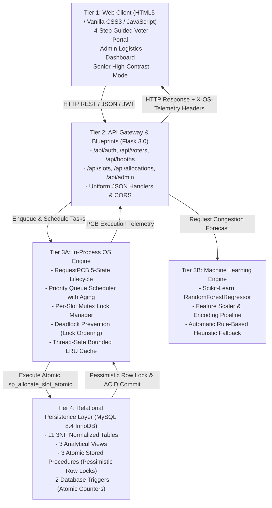
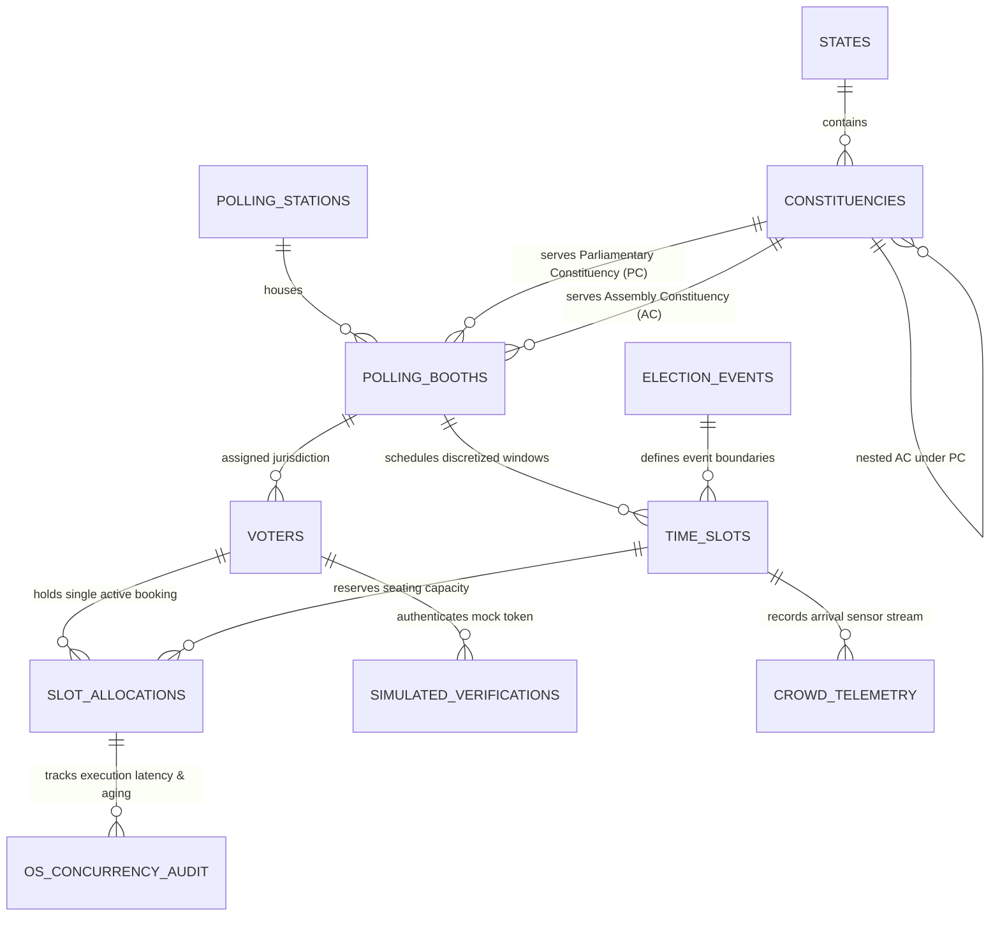
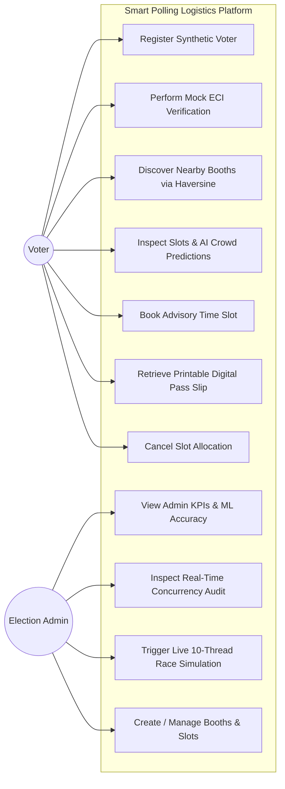
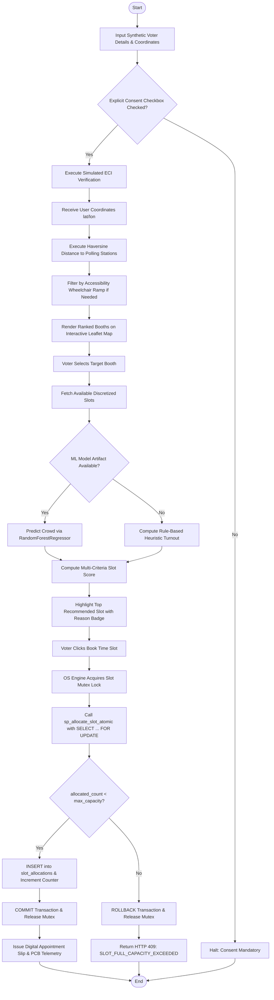
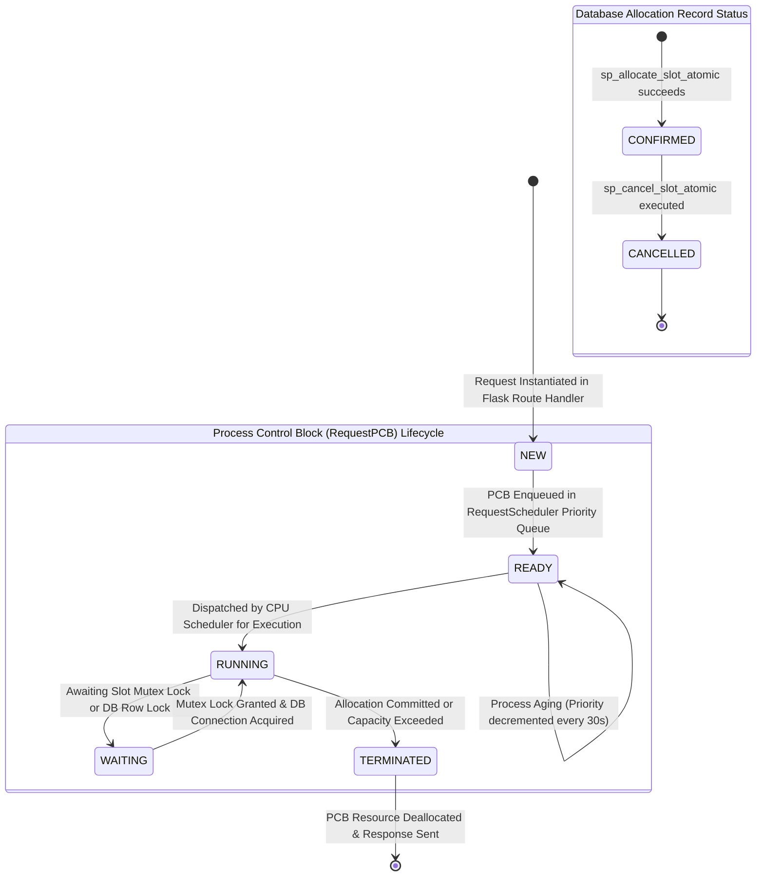

# System Diagrams Reference Specification (Mermaid Syntax)
## Project: Smart Polling Booth & Time-Slot Allocation Platform for One Nation One Election (ONOE)

This document provides all **9 architectural, behavioral, and structural diagrams** in valid Mermaid syntax. Each diagram is accompanied by an architectural caption explaining its significance in the platform's execution lifecycle. These diagrams can be directly rendered in Markdown viewers or exported for academic presentation slides and project reports.

---

## 1. System Architecture Diagram

**Caption:** *Five-tier decoupled architecture illustrating data flow from the responsive Web Client through the Flask REST API Gateway, the in-process OS Concurrency and Scikit-Learn Machine Learning engines, down to the MySQL 8.4 InnoDB transactional database.*



---

## 2. Data Flow Diagram (DFD Level 0 & Level 1)

**Caption:** *Contextual Level 0 and decomposed Level 1 Data Flow Diagram illustrating the flow of demographic information, mock verification tokens, spatial coordinates, time-slot reservations, and administrative telemetry.*

```mermaid
graph TD
    subgraph Level0["Level 0: Context Level DFD"]
        Voter0((Voter))
        Admin0((Election Admin))
        System0[Smart Polling Platform (ONOE)]
        Store0[(MySQL InnoDB DB)]

        Voter0 -->|Demographics & Coordinates| System0
        Voter0 -->|Consent & Mock OTP| System0
        Voter0 -->|Slot Reservation Request| System0
        System0 -->|Digital Appointment Pass| Voter0

        Admin0 -->|Credentials & Config| System0
        Admin0 -->|Trigger Race Simulation| System0
        System0 -->|Real-Time Telemetry & Charts| Admin0

        System0 <-->|ACID Reads & Writes| Store0
    end

    subgraph Level1["Level 1: Functional Decomposition"]
        P1[1.0 Voter Registration & Consent]
        P2[2.0 Simulated ECI Verification]
        P3[3.0 Haversine Spatial Booth Discovery]
        P4[4.0 AI Crowd Prediction & Slot Scoring]
        P5[5.0 OS Mutex & Atomic Slot Allocation]
        P6[6.0 Telemetry Aggregation & Concurrency Audit]

        D_Voters[(voters Table)]
        D_Booths[(polling_booths Table)]
        D_Slots[(time_slots Table)]
        D_Alloc[(slot_allocations Table)]
        D_Audit[(os_concurrency_audit Table)]

        P1 -->|Store Voter Record| D_Voters
        P2 -->|Verify Synthetic Identity| D_Voters
        P3 -->|Query Geocoordinates| D_Booths
        P4 -->|Fetch Turnout Telemetry| D_Slots
        P5 -->|Atomic Reservation & Lock| D_Slots
        P5 -->|Record Allocation| D_Alloc
        P5 -->|Emit Telemetry Trace| D_Audit
        P6 -->|Aggregate Capacity Utilization| D_Audit
    end
```

---

## 3. Entity-Relationship (ER) Diagram (All 11 Relational Tables)

**Caption:** *Complete 11-table entity-relationship model in Third Normal Form (3NF), capturing dual ONOE Parliamentary (PC) and Assembly (AC) constituency hierarchies, stations, booths, synthetic voters, time slots, allocations, sensor telemetry, and OS concurrency audit logs.*



---

## 4. UML Use-Case Diagram

**Caption:** *Use-case model delineating the interaction boundaries of the primary actors (Voter and Election Administrator) with the core logistics and telemetry capabilities.*



---

## 5. UML Activity Diagram (Verification & Slot Allocation Workflow)

**Caption:** *Detailed activity workflow modeling the end-to-end voter transaction from initial registration through consent verification, spatial ranking, machine learning crowd forecasting, OS mutual exclusion, and database commit.*



---

## 6. UML Sequence Diagram (Simultaneous Allocation Contention on Final Seat)

**Caption:** *Sequence interaction demonstrating how two concurrent voter worker threads contending for a single remaining slot (`max_capacity = 1`) are serialized by thread-level mutexes and database row-level locking (`SELECT ... FOR UPDATE`), guaranteeing Zero Overbooking.*

```mermaid
sequenceDiagram
    autonumber
    actor Thread1 as Thread 1 (Voter A)
    actor Thread2 as Thread 2 (Voter B)
    participant OS as OS SlotSyncManager
    participant DB as MySQL InnoDB (sp_allocate_slot_atomic)

    Note over Thread1, Thread2: Both threads release simultaneously at threading.Barrier(2)
    par Simultaneous Mutex Request
        Thread1->>OS: acquire_slot_lock(slot_id=999)
        Thread2->>OS: acquire_slot_lock(slot_id=999)
    end
    Note over OS: Thread 1 acquires Mutex; Thread 2 waits
    OS-->>Thread1: Mutex Granted
    Thread1->>DB: CALL sp_allocate_slot_atomic(voter_A, slot_999)
    DB->>DB: START TRANSACTION
    DB->>DB: SELECT allocated_count, max_capacity FROM time_slots WHERE slot_id=999 FOR UPDATE
    Note over DB: Exclusive Row Lock (X-Lock) placed on slot 999
    DB->>DB: Check: allocated_count (0) < max_capacity (1) -> TRUE
    DB->>DB: INSERT INTO slot_allocations (voter_A, slot_999)
    DB->>DB: UPDATE time_slots SET allocated_count = 1
    DB->>DB: COMMIT (Releases Row Lock)
    DB-->>Thread1: SUCCESS (booking_reference_token = TKN-UK-001)
    Thread1->>OS: release_slot_lock(slot_id=999)
    Note over OS: Mutex released and granted to Thread 2
    OS-->>Thread2: Mutex Granted
    Thread2->>DB: CALL sp_allocate_slot_atomic(voter_B, slot_999)
    DB->>DB: START TRANSACTION
    DB->>DB: SELECT allocated_count, max_capacity FROM time_slots WHERE slot_id=999 FOR UPDATE
    Note over DB: Exclusive Row Lock (X-Lock) placed on slot 999
    DB->>DB: Check: allocated_count (1) < max_capacity (1) -> FALSE
    DB->>DB: SIGNAL SQLSTATE '45000' (SLOT_FULL_CAPACITY_EXCEEDED)
    DB->>DB: ROLLBACK (Releases Row Lock)
    DB-->>Thread2: REJECTED (status: SLOT_FULL_CAPACITY_EXCEEDED)
    Thread2->>OS: release_slot_lock(slot_id=999)
```

---

## 7. Flowchart for Booth & Time-Slot Selection (with ML Fallback)

**Caption:** *Decision flowchart depicting the multi-stage slot recommendation pipeline, showcasing automatic detection of machine learning artifact availability and graceful fallback to rule-based heuristics.*

```mermaid
flowchart TD
    A[Start: Query Available Slots for Booth] --> B[Retrieve Discretized Slots from DB]
    B --> C{Check ML Model Artifacts<br/>rf_crowd_model.joblib exists?}
    C -- Yes --> D[Load Feature Scaler & Extract Features:<br/>hour_of_day, max_capacity, historical_avg,<br/>weather, is_morning_peak]
    D --> E[Run RandomForestRegressor.predict]
    E --> F[Inference Succeeded?]
    F -- Yes --> G[Assign Predicted Crowd Volume to Slots]
    F -- No --> H[Catch Exception & Log Warning]
    C -- No --> H
    H --> I[Apply Rule-Based Heuristic Formula:<br/>Crowd = max_capacity * 0.65 if morning else 0.40]
    I --> G
    G --> J[Compute Multi-Criteria Slot Score:<br/>Score = 0.5*(1-Crowd/Cap) + 0.3*(1-Alloc/Cap) + 0.2*PriorityBonus]
    J --> K[Rank Slots in Descending Order of Score]
    K --> L[Select Highest Scoring Slot as Recommended]
    L --> M[Generate Explainable Recommendation Reason Badge]
    M --> N[Return JSON Response with All Slots & Recommended Slot]
    N --> O([End])
```

---

## 8. Deployment Diagram

**Caption:** *Physical and process deployment topology showing client browser environments communicating over local loopback interfaces with the Python/Flask WSGI application server and the standalone MySQL 8.4 database daemon.*

```mermaid
graph TD
    subgraph HostWorkstation["Local Development Workstation (Host OS)"]
        subgraph BrowserTier["Client Browser Environment (Port Dynamic)"]
            DOM["DOM Tree & HTML5 / CSS3 Layout"]
            JS_Client["api_client.js & voter_portal.js"]
            Leaflet_Engine["Leaflet.js Interactive Map Engine"]
            Chart_Engine["Chart.js Analytics Canvas Engine"]
        end

        subgraph ServerTier["Flask Application Server (Port 5000)"]
            WSGI["Werkzeug WSGI Server Dispatcher"]
            AppFactory["Flask Application Factory (create_app)"]
            Blueprints["Modular Blueprints (Auth, Voter, Booth, Alloc, Admin)"]
            OS_Engine["In-Process OS Engine (PCB, Scheduler, Mutex, LRU)"]
            ML_Engine["Scikit-Learn Random Forest Estimator"]
            StaticServer["Static Asset Dispatcher (frontend/css, frontend/js)"]
        end

        subgraph DatabaseTier["MySQL Community Server (Port 3306)"]
            ConnPool["mysql.connector.pooling.MySQLConnectionPool"]
            SQL_Engine["InnoDB Storage Engine (ACID Transaction Manager)"]
            TablesStorage["Data Files & B-Tree Indexes (smart_poll_allocation_db)"]
            SPs["Compiled Stored Procedures & Triggers"]
        end
    end

    BrowserTier <-->|HTTP / JSON (RESTful API)| ServerTier
    ServerTier <-->|TCP / IP (Native MySQL Protocol)| DatabaseTier
```

---

## 9. State Diagram (OS Request PCB Lifecycle & Allocation Status)

**Caption:** *State transition diagram mapping the complete lifecycle of an incoming voter request encapsulated within an Operating System Process Control Block (`RequestPCB`), alongside the corresponding database booking record status.*


