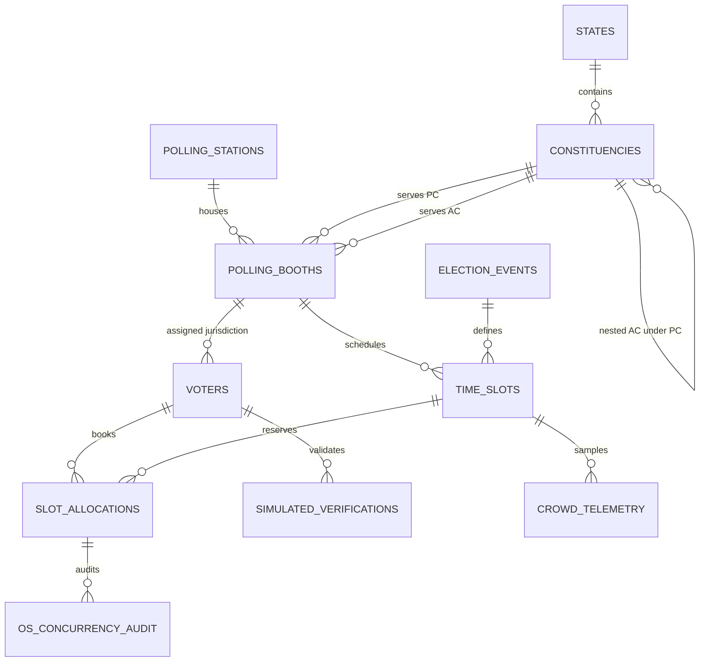

# Database Design & 3NF Normalization Specification

**Project Title:** Smart Polling Booth & Time-Slot Allocation Platform for One Nation One Election  
**Academic Level:** B.Tech CSE (AI/ML) & OS/DBMS Project-Based Learning  
**Database Engine:** MySQL 8.0+ (InnoDB Storage Engine)  
**Encoding:** `utf8mb4` with `utf8mb4_unicode_ci`  

---

## 1. Architectural Guardrails & Legal Compliance

> [!IMPORTANT]
> **Strict Logistics Scope Only:** This database manages polling booth allocation, simulated voter authentication, queue time-slot scheduling, and crowd prediction telemetry for simultaneous Lok Sabha and Vidhan Sabha elections. It explicitly contains **NO** candidate records, **NO** ballot casting, **NO** political party data, and **NO** election outcome prediction.

> [!NOTE]
> **100% Synthetic Identifiers:** Every voter identifier uses the synthetic demo format `DEM-UK-2026-XXXX`. No real voter cards, Aadhaar numbers, or biometric fingerprints are collected or stored.

---

## 2. 3NF (Third Normal Form) Mathematical Justification

A relational schema is in **Third Normal Form (3NF)** if and only if for every non-trivial functional dependency $X \to Y$:
1. $X$ is a superkey, OR
2. $Y$ is a prime attribute (part of a candidate key).

### Normalization Audit by Entity

| Entity Table | Primary Key | Candidate Keys | Functional Dependencies ($X \to Y$) | 3NF Compliance Status |
| :--- | :--- | :--- | :--- | :--- |
| `states` | `state_id` | `state_code` | `state_id` $\to$ `state_code`, `state_name` | **Compliant**: Determinant is PK. No transitive dependencies. |
| `constituencies` | `constituency_id` | `constituency_code` | `constituency_id` $\to$ `state_id`, `constituency_name`, `constituency_type`, `parent_pc_id`, `total_registered_voters` | **Compliant**: All non-prime attributes functionally depend on PK. |
| `polling_stations` | `station_id` | `station_code` | `station_id` $\to$ `station_code`, `station_name`, `address`, `pincode`, `latitude`, `longitude`, `total_booths`, `has_wheelchair_ramp` | **Compliant**: Physical campus coordinates and infrastructure directly depend on station ID. |
| `polling_booths` | `booth_id` | (`station_id`, `booth_number`) | `booth_id` $\to$ `station_id`, `pc_id`, `ac_id`, `booth_number`, `room_number`, `max_capacity_per_slot`, `evm_units_count` | **Compliant**: Maps physical station room to dual ONOE constituencies (PC & AC). |
| `voters` | `voter_id` | `demo_epic_no` | `voter_id` $\to$ `demo_epic_no`, `full_name`, `dob`, `gender`, `address_zone`, `pincode`, `special_category`, `priority_level`, `assigned_booth_id` | **Compliant**: All demographic and priority fields depend strictly on synthetic voter ID. |
| `election_events` | `event_id` | — | `event_id` $\to$ `event_name`, `event_type`, `election_date`, `start_time`, `end_time`, `status` | **Compliant**: Temporal cycle data depends solely on event ID. |
| `time_slots` | `slot_id` | (`booth_id`, `event_id`, `slot_date`, `start_time`) | `slot_id` $\to$ `booth_id`, `event_id`, `slot_date`, `start_time`, `end_time`, `max_capacity`, `allocated_count`, `priority_reserved_capacity`, `status` | **Compliant**: Booth discretization windows depend on slot ID. |
| `slot_allocations` | `allocation_id` | `booking_reference_token`, (`voter_id`, `event_id`) | `allocation_id` $\to$ `voter_id`, `booth_id`, `slot_id`, `event_id`, `booking_reference_token`, `allocation_type`, `priority_score`, `queue_token_no`, `status`, `booked_at` | **Compliant**: Single reservation instance per voter per election event. |
| `simulated_verifications` | `verification_id` | — | `verification_id` $\to$ `voter_id`, `booth_id`, `simulated_token`, `verification_method`, `status`, `verified_at` | **Compliant**: Simulated token check audit depends on verification ID. |
| `crowd_telemetry` | `telemetry_id` | — | `telemetry_id` $\to$ `booth_id`, `slot_id`, `timestamp`, `current_queue_length`, `avg_service_time_seconds`, `congestion_index` | **Compliant**: Sensor time series row depends on telemetry ID. |
| `os_concurrency_audit` | `audit_id` | — | `audit_id` $\to$ `thread_name`, `voter_id`, `booth_id`, `slot_id`, `operation_type`, `status_code`, `execution_latency_ms` | **Compliant**: Thread-level lock and aging audit trail. |

---

## 3. Relational Schema Architecture (One Nation One Election)

---

## 4. ACID Transactions & Concurrency Safe Locking

### Row-Level Locking (`SELECT ... FOR UPDATE`)
To prevent overbooking when multiple concurrent worker threads request reservations for the same time slot:
1. `START TRANSACTION;`
2. `SELECT ... FROM time_slots WHERE slot_id = ? FOR UPDATE;`
   - InnoDB places an **exclusive row lock ($X$-lock)** on the slot record.
   - Other transactions attempting to book the same slot wait until the lock is released or timeout (`OS_LOCK_TIMEOUT_SECONDS`).
3. Validate capacity: `allocated_count < max_capacity` (or `max_capacity + priority_reserved_capacity` for Priority Level 1).
4. `INSERT INTO slot_allocations (...) VALUES (...);`
5. Trigger `trg_after_allocation_insert` increments `allocated_count`.
6. `COMMIT;` (releases lock atomically).

### Stored Procedures Single Source of Truth
- `sp_allocate_slot_atomic`: Atomic, deadlock-resilient slot reservation with priority tier checks.
- `sp_cancel_slot_atomic`: Atomic reservation cancellation with automatic capacity decrement.
- `sp_log_os_concurrency_event`: High-throughput audit logging for OS synchronization and priority aging metrics.

---

## 5. Analytical Views

1. **`vw_booth_live_status`**: Real-time load monitor combining station geography, Parliamentary Constituency, Assembly Constituency, slot capacities, available seats, and capacity utilization percentage.
2. **`vw_voter_appointment_slip`**: Complete voter slip metadata including voter details, room number, station address, time slot window, and queue token number.
3. **`vw_constituency_logistics_summary`**: High-level rollup for election commissioners and logistical coordinators to observe booking distributions across Parliamentary and Assembly constituencies.
